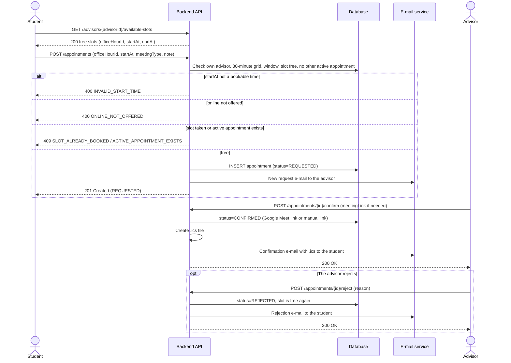
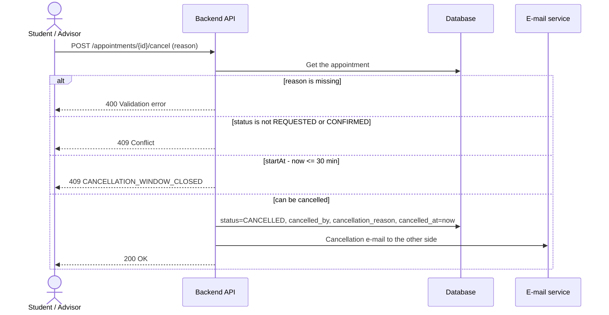
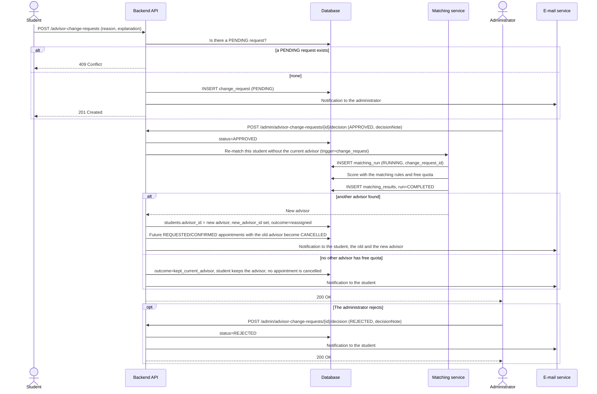
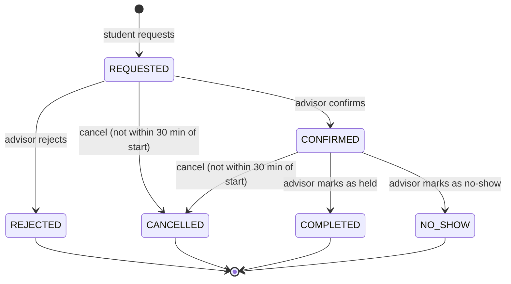

# Sequence: Appointment and Advisor Change

> Issue #68 · Reviewers: Nil, Fatima
> Paths, bodies and status codes follow `openapi.yaml` v0.5.0 (#70).

## 1. Appointment: request, confirm, e-mail with .ics

## 2. Cancellation and the 30-minute lock

An appointment cannot be cancelled by either side within 30 minutes of its start.

## 3. Advisor change request and re-matching

## 4. Appointment state diagram

