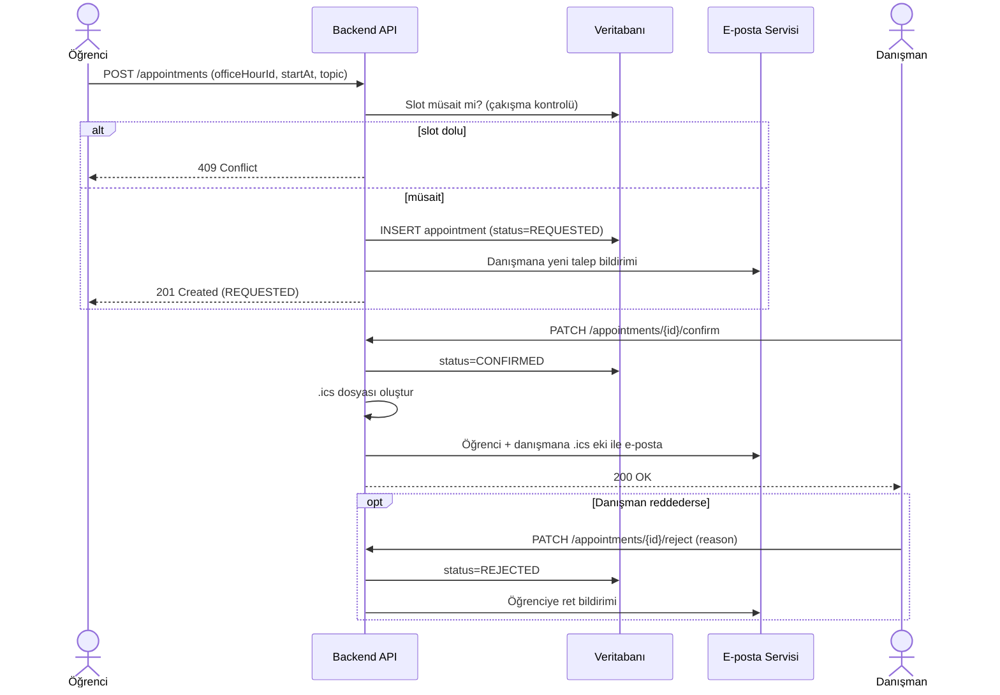
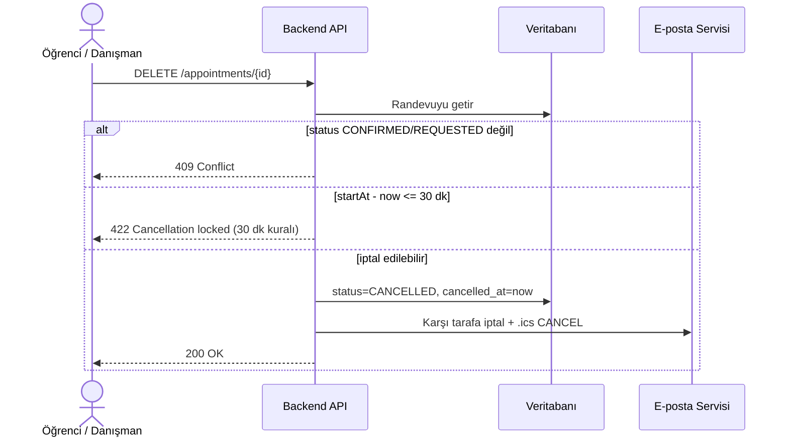
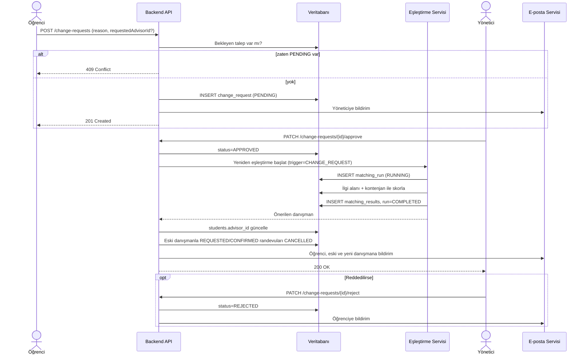
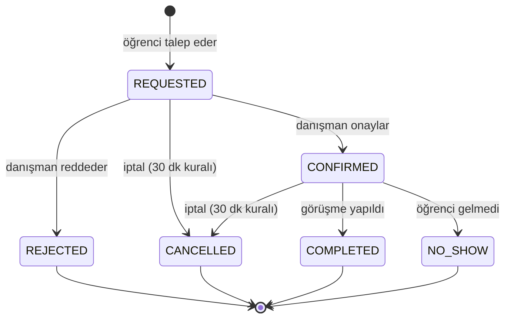

# Sequence: Randevu ve Danışman Değişikliği

> Issue #68 · İnceleyenler: Nil, Fatima

## 1. Randevu: talep → onay → .ics e-postası

## 2. İptal ve 30 dk kilidi

Randevu başlangıcına 30 dakika veya daha az kaldıysa iptal edilemez.

## 3. Danışman değişikliği talebi ve yeniden eşleştirme

## 4. Randevu durum diyagramı

