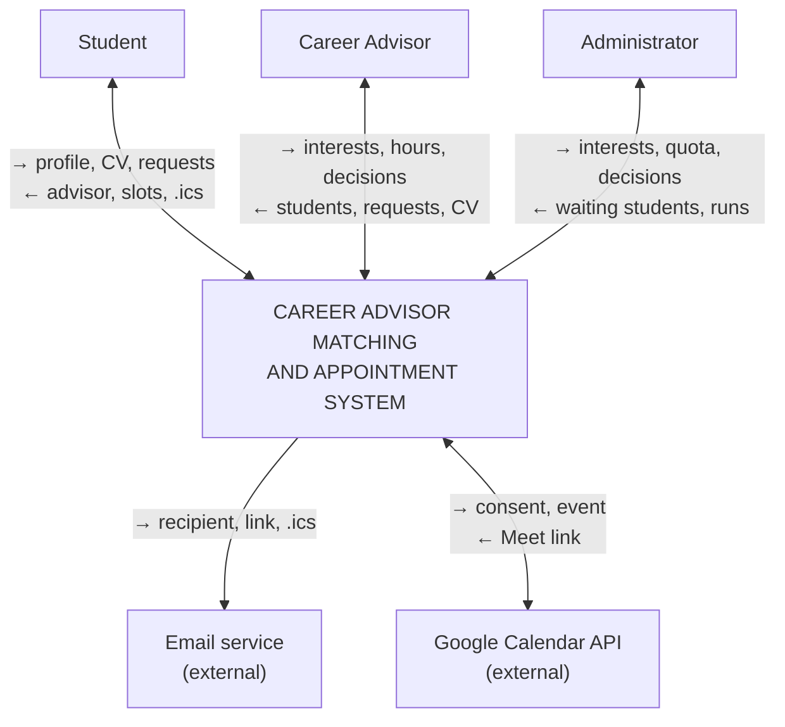
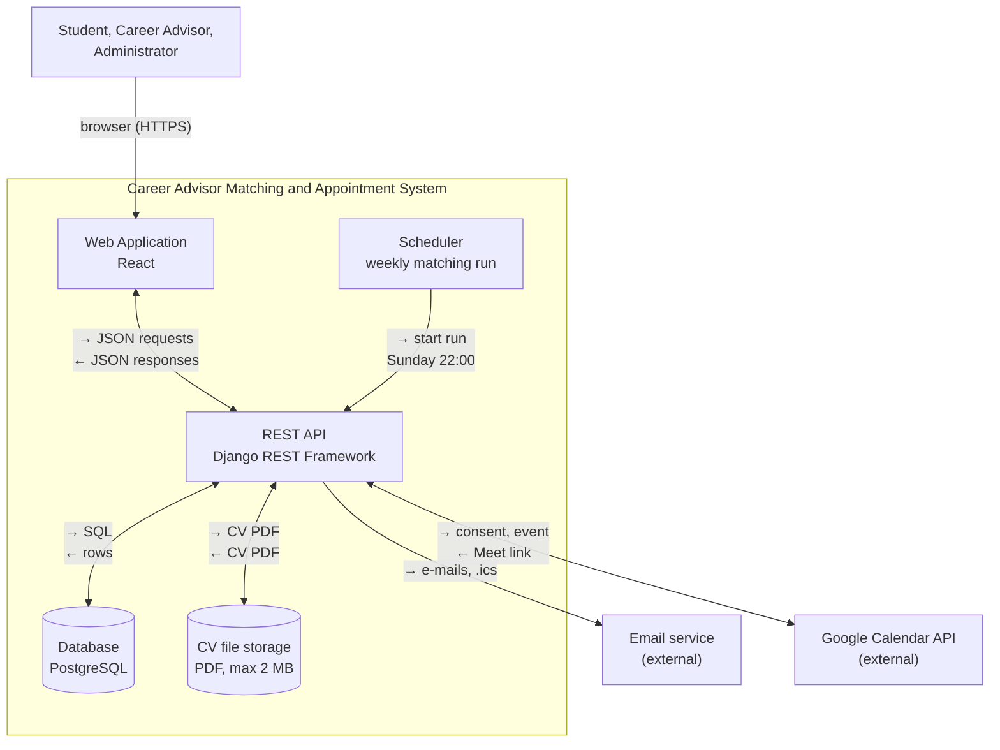
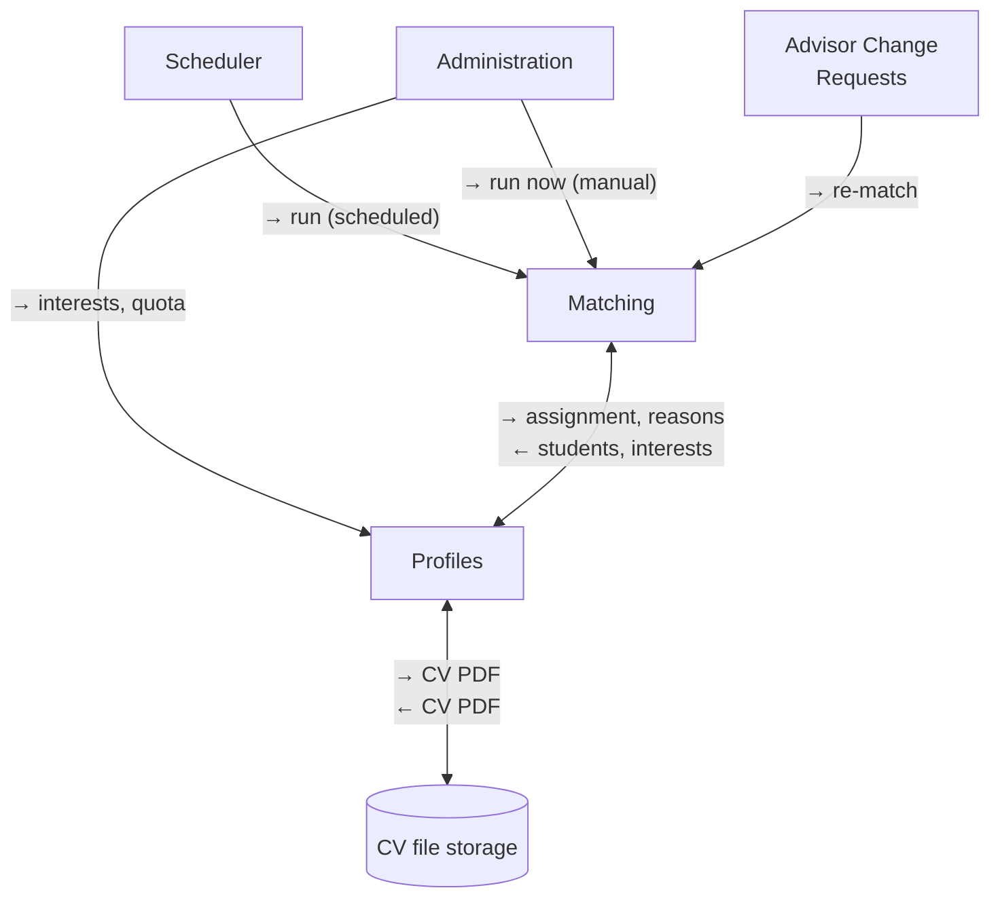
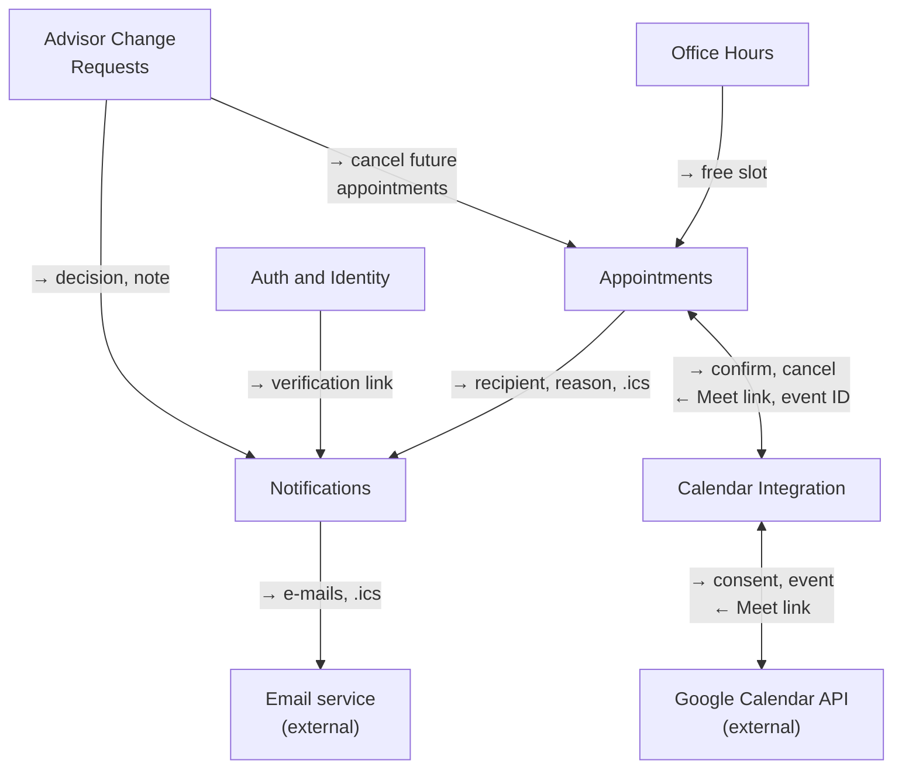

# C4 Architecture: Career Advisor Matching and Appointment System

| Item | Value |
|---|---|
| Project | Career Advisor Matching and Appointment System (SENG 321, Team 8) |
| Sprint | Sprint 2 |
| Issue | #65 |
| Owner | Fatima (Lead Software Architect) |
| Reviewer | Aybüke |
| Related decisions | D-14 to D-27 in `docs/decision.md`; the technology stack is D-27 |
| Related documents | `docs/vision-boundary.md` (system boundary), `openapi.yaml` (API contract) |

This document describes the architecture at three C4 levels: **Context** (level 1), **Container** (level 2) and **Component** (level 3). Every arrow in the diagrams is labeled with the information that travels along it. The diagrams are written in Mermaid and render on GitHub.

In the component diagram, Access Control is a layer that every request passes through, so it is described in the table and not drawn with its own arrows.

Names (roles, statuses, modules) match `openapi.yaml`. Statuses of an appointment are `REQUESTED`, `CONFIRMED`, `REJECTED`, `CANCELLED`, `COMPLETED` and `NO_SHOW`.

## 1. Level 1: System Context

The system is shown as one box. It is the same boundary as in `docs/vision-boundary.md`.

How to read it: `→` is information flowing left to right, `←` right to left.

| Arrow | Information |
|---|---|---|
| Student ↔ System | Profile, CV, appointment requests; advisor and match reasons, free slots, appointment status, `.ics` |
| Career Advisor ↔ System | Interests, served years, bio, office hours, appointment decisions; students, appointment requests, CV |
| Administrator ↔ System | Interests, accounts, quota, change-request decisions, manual matching run; waiting students, change requests, run history |
| System → Email service | Recipient, verification link, appointment summary, `.ics` |
| System ↔ Google Calendar API | OAuth consent, event details; Meet link, event ID |

| Element | Type | Responsibility |
|---|---|---|
| Student | Person | Registers, fills a profile, sees the assigned advisor and why, requests and cancels appointments, uploads a CV, may request an advisor change |
| Career Advisor | Person | Sets interests, served years, bio and office hours, confirms or rejects appointment requests, sees assigned students and their CVs |
| Administrator | Person | Manages the interest list, advisor accounts and quota, decides on change requests, can start a matching run |
| Email service | External system | Delivers verification and appointment e-mails |
| Google Calendar API | External system | Creates a Google Meet link for a confirmed online appointment (only if the advisor connected Google) |

## 2. Level 2: Containers

| Arrow | Information |
|---|---|
| Users → Web Application | Pages in the browser (HTTPS) |
| Web Application ↔ REST API | JSON requests with a bearer token (registration, profile, appointment actions, CV upload); JSON responses (advisor, match reasons, slots, statuses, errors, `.ics`) |
| Scheduler → REST API | Start of the weekly matching run, Sunday 22:00 Europe/Istanbul |
| REST API ↔ Database | Users, profiles, interests, slots, appointments, change requests, matching runs (SQL); rows |
| REST API ↔ CV file storage | CV PDF file |
| REST API → Email service | Recipient, verification link, appointment summary, `.ics` (SMTP) |
| REST API ↔ Google Calendar API | OAuth consent, event details; Meet link, event ID |

| Container | Technology | Responsibility | Decision |
|---|---|---|---|
| Web Application | React, JavaScript, HTML, CSS | All screens for the three roles, mobile-friendly. Talks to the API only; holds no business rules | D-27 |
| REST API | Python, Django REST Framework | Business rules, role checks, privacy rules (GPA, CV, change-request explanation), matching engine, appointment rules, e-mail and Google integration | D-14 to D-26, D-27 |
| Database | PostgreSQL | Users, profiles, interests, office hours, appointments, change requests, matching runs and their results | D-27 |
| CV file storage | Server file volume (mounted into the API container) | PDF files of the CVs. Files are served only through the API after a role check | D-16 |
| Scheduler | Container that runs the Django management command for matching on a schedule | Starts the weekly matching run (Sunday 22:00 Europe/Istanbul). The administrator can also start a run through the API | D-20 |
| Email service | External | Delivers e-mails | D-19 |
| Google Calendar API | External | Meet link and event for confirmed online appointments | D-15 |

Notes:
- The exact scheduling tool and the container layout (`docker-compose`) are described in `docs/architecture/deployment.md` (#66).
- The CV file storage is a design choice made here. Keeping files outside the database keeps the database small, and the API remains the only way to read a file.

## 3. Level 3: Components of the REST API

Level 3 is split into two diagrams so that every arrow stays readable: **3a** shows matching and profiles, **3b** shows appointments, notifications and the Google integration.

### 3a. Matching and profiles

| Arrow | Information |
|---|---|
| Scheduler → Matching | Start of the weekly run (trigger `scheduled`, Sunday 22:00 Europe/Istanbul) |
| Administration → Matching | Manual run requested by the administrator (trigger `manual`) |
| Advisor Change Requests → Matching | Re-match request for a student, excluding the old advisor |
| Administration → Profiles | Interest list, advisor accounts, quota |
| Matching ↔ Profiles | Matching reads waiting students (year, department, interests) and advisors (interests, served years, quota); it returns the assignment, the round, the score and the shared interests |
| Profiles ↔ CV file storage | CV PDF file (upload, download) |

### 3b. Appointments, notifications and Google integration

| Arrow | Information |
|---|---|
| Office Hours → Appointments | A free 30-minute slot of the student's assigned advisor |
| Advisor Change Requests → Appointments | Order to cancel the future appointments with the old advisor |
| Appointments → Notifications | Recipient, reason, `.ics` file for request, confirmation, rejection and cancellation e-mails |
| Auth and Identity → Notifications | Recipient and verification link |
| Advisor Change Requests → Notifications | Recipient, decision and administrator note |
| Appointments ↔ Calendar Integration | Confirmed online appointment or cancellation; the Meet link and event ID come back |
| Notifications → Email service | Recipient, subject, body, `.ics` (SMTP) |
| Calendar Integration ↔ Google Calendar API | OAuth consent, event details; Meet link, event ID |

### Components, responsibilities and decisions

| Component | Responsibility | OpenAPI tags and operations | Decisions |
|---|---|---|---|
| Auth and Identity | Registration for the `s` + 9-digit student address, e-mail verification, login. Advisor accounts cannot self-register | Auth: `registerStudent`, `verifyEmail`, `resendVerification`, `login` | D-14 |
| Access Control (cross-cutting layer, not drawn as a box) | Checks the role on every request. Returns 401 (no token) and 403 (wrong role or other person's data). Applies the privacy rules | All operations | D-26 |
| Profiles | Student profile (year, department, GPA, interests), advisor profile (interests, served years, bio, online preference), CV upload and download, advisor with match reasons | Student, Advisor, Reference | D-16, D-22, D-23, D-24, D-25 |
| Administration | Interest list, advisor accounts, quota (default 20, not below the current student count), waiting students, starting a matching run | Admin | D-17, D-25 |
| Matching | Weekly batch (Sunday 22:00). Score = 2 × shared interests + 1 same department + 1 served year. Round 1: served year and a shared interest. Round 2: year requirement dropped. Round 3: most free quota, same department first, random on ties (fixed seed in tests). Students are processed fewest-options-first, then by registration time. Stores the run and the match reasons | Admin: `runMatchingNow`, `listMatchingRuns`; Student: `getMyAdvisor` | D-20, D-24 |
| Office Hours | The advisor adds weekly office hours (day and time range); the system derives the free 30-minute slots | Advisor: `createOfficeHour`, `listMyOfficeHours`, `deleteOfficeHour`; Student: `listAvailableSlots` | D-18 |
| Appointments | Request (`REQUESTED`), confirm (`CONFIRMED`), reject (`REJECTED`), cancel with a reason (`CANCELLED`, not within 30 minutes of the start), outcome (`COMPLETED`, `NO_SHOW`). One booking per slot (409), one active appointment per student | Appointments: `requestAppointment`, `confirmAppointment`, `rejectAppointment`, `cancelAppointment`, `markAppointmentOutcome`, `downloadAppointmentCalendar` | D-15, D-18 |
| Advisor Change Requests | One pending request at a time, reason and explanation (at least 20 characters), administrator decision. If approved, re-matching excludes the old advisor. If no other advisor is available, the student stays | ChangeRequests: `createAdvisorChangeRequest`, `listAdvisorChangeRequests`; Admin: `decideAdvisorChangeRequest` | D-21 |
| Notifications | E-mails for verification, appointment request, confirmation or rejection, and cancellation. The confirmation carries an .ics file | (no endpoint of its own) | D-19 |
| Calendar Integration | Google OAuth connection of the advisor. Creates a Meet link when an online appointment is confirmed, deletes the event on cancellation. If not connected, the advisor enters a link manually | Advisor: `getGoogleCalendarStatus`, `startGoogleCalendarConnect`, `completeGoogleCalendarConnect`, `disconnectGoogleCalendar` | D-15 |

## 4. Design Notes

- **Business rules live in the API only.** The web application only shows screens and sends requests, so the rules (30-minute cancellation lock, one active appointment, quota) cannot be bypassed from the browser.
- **Matching is a batch, not a request.** A profile save never matches a student immediately. This is why the scheduler and the manual run both call the same Matching component.
- **Privacy is a separate component.** Access Control decides who sees the GPA, the CV and a change-request explanation, so the rule is written once.
- **Integrations are optional.** If Google Calendar is not connected, the appointment still works with a manual link. If an e-mail cannot be sent, the status is still visible in the system.
- **Open point.** After a change request is approved and the student is re-matched, the future appointments with the old advisor are cancelled (as in the OpenAPI draft). D-21 does not say this explicitly. It should be confirmed with the Product Owner and, if accepted, added to the decision log.
