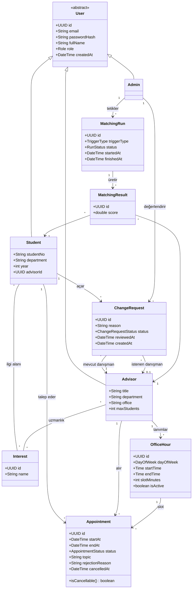
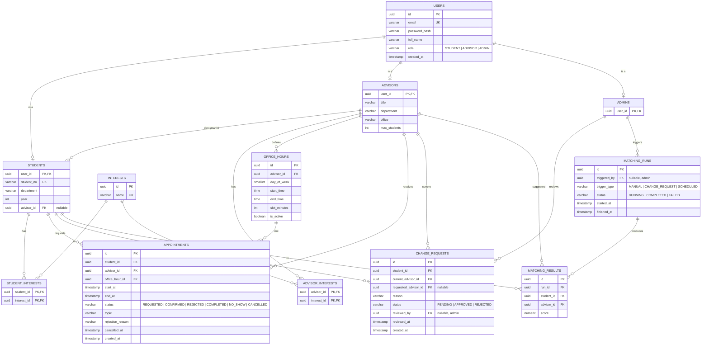

# Class Diagram ve Veritabanı (ER)

> Issue #69 · İnceleyenler: Ebrar, Fatima
> Not: İsimler OpenAPI şemalarıyla aynı olmalı. Şüpheli alanlar `TODO(openapi)` ile işaretlendi, OpenAPI'ye bakıp eşitlenecek.

## 1. Class Diagram

## 2. ER Diyagramı

## 3. Kısıtlar ve notlar

- `appointments`: aynı `advisor_id` için çakışan `[start_at, end_at)` aralığında `REQUESTED`/`CONFIRMED` kayıt olamaz (exclusion constraint veya servis katmanı kontrolü).
- `students.advisor_id` sayısı `advisors.max_students` değerini geçemez.
- `change_requests`: bir öğrencinin aynı anda tek `PENDING` talebi olabilir.
- `matching_results`: `(run_id, student_id)` benzersiz.
- Rol ayrımı `users.role` ile yapılır; alt tablolar (`students`, `advisors`, `admins`) `user_id` ile PK paylaşır.
- TODO(openapi): alan adları (`studentNo`, `slotMinutes`, `topic` vb.) camelCase/snake_case olarak OpenAPI ile birebir eşitlenecek.
