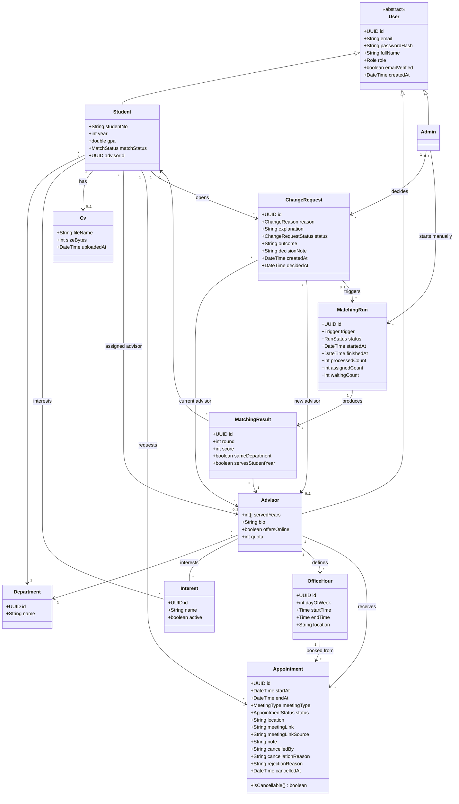
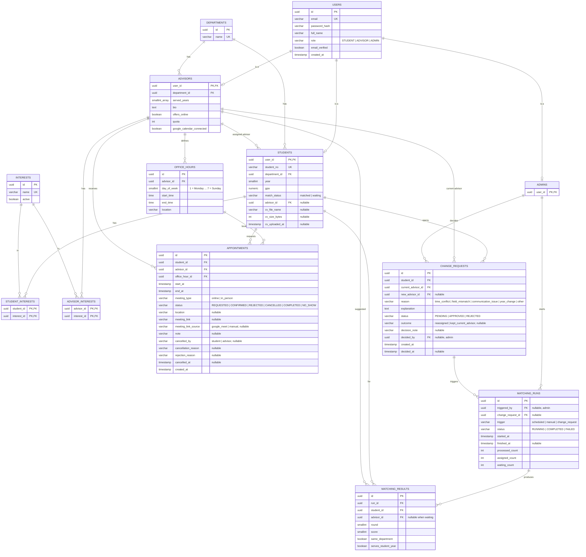

# Class Diagram and Database (ER)

> Issue #69 · Reviewers: Ebrar, Fatima
> Names follow `openapi.yaml` v0.5.0 (#70). API fields are camelCase; database columns are the same names in snake_case.

## 1. Class diagram

Notes
- `studentNo` is derived from the e-mail address (`s` + 9 digits). It is read-only and unique.
- Office hours are weekly rules. Free 30-minute slots are computed from them and are not stored.
- `Advisor.quota` replaces `maxStudents` (D-17).
- `ChangeRequest.newAdvisorId` is set only when an approved request is re-matched.

## 2. ER diagram

## 3. Constraints and notes

- `appointments`: for the same `advisor_id` and `start_at`, at most one `REQUESTED` or `CONFIRMED` row (unique partial index). This gives exactly one winner when two students request the same slot (FR-26).
- `appointments`: `start_at` must be on a 30-minute boundary inside an office-hour rule of that advisor; `end_at = start_at + 30 minutes`.
- A student has at most one active (`REQUESTED` or `CONFIRMED`) appointment.
- Cancellation is not allowed within 30 minutes of `start_at` (409 `CANCELLATION_WINDOW_CLOSED`).
- The number of students with the same `advisor_id` cannot exceed `advisors.quota`; the quota cannot be set below that number.
- `change_requests`: a student has at most one `PENDING` request.
- `matching_results`: `(run_id, student_id)` is unique.
- `office_hours`: rules of the same advisor on the same day cannot overlap; the duration is a multiple of 30 minutes.
- Role is stored in `users.role`; `students`, `advisors` and `admins` share the primary key with `users.id`.
- Privacy: `students.gpa`, the CV and `change_requests.explanation` follow the visibility rules of FR-40.
