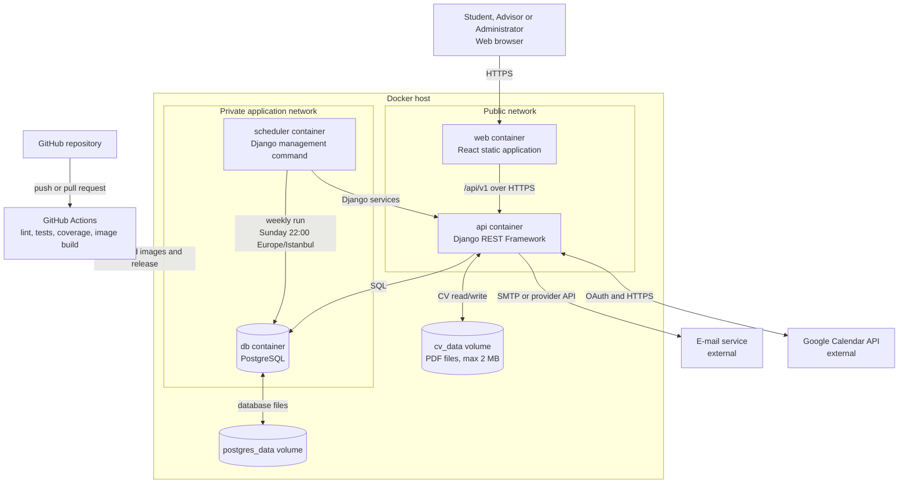

# Deployment View

| Item | Value |
|---|---|
| Project | Career Advisor Matching and Appointment System (SENG 321, Team 8) |
| Sprint | Sprint 2 |
| Issue | #66 |
| Owner | Yağız (DevOps and CI/CD Infrastructure Engineer) |
| Reviewer | Nil |
| Related decision | D-27 in `docs/decision.md` |
| Related architecture | `docs/architecture/c4.md` |

This document defines the planned deployment of the system. It follows D-27: a React web client, a Django REST Framework API, PostgreSQL, Docker Compose, an external e-mail service and the Google Calendar API. The same container boundaries are used for local development and the course demonstration so that the team tests the topology it presents.

## 1. Deployment diagram



The database is not exposed to the public network. Only the web application and API receive user traffic. The API is the sole gateway to PostgreSQL and CV files, so role and ownership checks cannot be bypassed by the browser.

## 2. Containers and runtime responsibilities

| Service | Technology | Responsibility | Exposed interface | Persistent data |
|---|---|---|---|---|
| `web` | React, JavaScript, HTML and CSS | Serves the responsive interface and calls the REST API | HTTP in local development; HTTPS through the deployment entry point | None |
| `api` | Python, Django REST Framework | Authentication, authorization, profiles, matching rules, appointments, CV access, notifications and integrations | `/api/v1` | CV files through `cv_data` |
| `db` | PostgreSQL | Stores users, profiles, interests, office hours, appointments, matching runs and change requests | Port 5432 on the private Compose network only | `postgres_data` |
| `scheduler` | The same Django image as `api` | Runs the weekly matching management command at Sunday 22:00 Europe/Istanbul | No public port | Uses `db`; matching-run records are persisted there |

External services are not placed in Docker Compose:

- the e-mail provider delivers verification and appointment messages;
- the Google Calendar API creates events and Meet links for advisors who connect it.

## 3. Docker Compose layout

The planned `docker-compose.yml` contains the four services above, one private application network and two named volumes.

```text
docker-compose.yml
├── web
│   └── depends on api
├── api
│   ├── depends on db health check
│   └── mounts cv_data
├── scheduler
│   ├── uses the api image and Django settings
│   └── depends on db health check
├── db
│   └── mounts postgres_data
├── networks
│   └── app_private
└── volumes
    ├── postgres_data
    └── cv_data
```

The target developer command is:

```bash
docker-compose up --build
```

The stack is ready when the PostgreSQL health check succeeds, Django migrations have completed, the API health endpoint responds and the web application can reach `/api/v1`.

## 4. Configuration and secrets

Configuration is supplied through environment variables. `.env.example` documents required names without real credentials; `.env` and secret values are never committed.

| Variable group | Examples | Consumer |
|---|---|---|
| Django | `DJANGO_SECRET_KEY`, `DJANGO_DEBUG`, `ALLOWED_HOSTS` | `api`, `scheduler` |
| Database | `POSTGRES_DB`, `POSTGRES_USER`, `POSTGRES_PASSWORD`, `DATABASE_URL` | `api`, `scheduler`, `db` |
| Web/API | `API_BASE_URL`, `CORS_ALLOWED_ORIGINS` | `web`, `api` |
| E-mail | `EMAIL_HOST`, `EMAIL_PORT`, `EMAIL_HOST_USER`, `EMAIL_HOST_PASSWORD`, `DEFAULT_FROM_EMAIL` | `api` |
| Google Calendar | `GOOGLE_CLIENT_ID`, `GOOGLE_CLIENT_SECRET`, `GOOGLE_REDIRECT_URI` | `api` |
| Scheduling | `TZ=Europe/Istanbul`, matching schedule expression | `scheduler` |

Production traffic uses HTTPS. PostgreSQL and the scheduler have no public ports. CV downloads pass through authenticated API endpoints, and backups include both named volumes.

## 5. Planned CI/CD pipeline

```mermaid
flowchart LR
    PR["Pull request to develop or main"]
    LINT["Lint and static checks"]
    TEST["Unit and integration tests"]
    COV["Coverage gate<br/>at least 50%"]
    BUILD["Build API and web images"]
    SMOKE["Docker Compose smoke test"]
    REVIEW["Required approval"]
    MERGE["Merge"]
    RELEASE["Tagged release"]

    PR --> LINT --> TEST --> COV --> BUILD --> SMOKE --> REVIEW --> MERGE --> RELEASE
```



The pipeline is planned as GitHub Actions in `.github/workflows/ci.yml` (#85):

1. run on pull requests targeting `develop` or `main`;
2. install locked dependencies and run lint checks;
3. run backend tests with `pytest-cov` and fail below 50 percent coverage;
4. build the API and web images;
5. start Docker Compose and run a health/smoke check;
6. publish no secrets and persist only test reports as workflow artifacts;
7. expose the CI result as a required ruleset status check.

Merging and release publication remain manual and require the repository ruleset approval. A future production environment may pull versioned images after a release tag, but automatic production deployment is outside Sprint 2.

## 6. Operational checks

| Check | Expected result |
|---|---|
| `docker-compose config` | Configuration is valid and contains no unresolved required variables |
| Database health check | PostgreSQL accepts connections before Django starts |
| API health check | API responds successfully after migrations |
| Web smoke check | The browser application loads and reaches the API |
| Scheduler check | A single scheduled run starts at Sunday 22:00 Europe/Istanbul; overlapping runs are rejected |
| Persistence check | Restarting containers keeps PostgreSQL and CV data |
| Security check | Database is private, secrets are absent from Git, and protected data is served only through the API |

This is the deployment design for Sprint 2. The executable Compose stack is delivered separately by issue #84 and the enforced CI workflow by issue #85.
