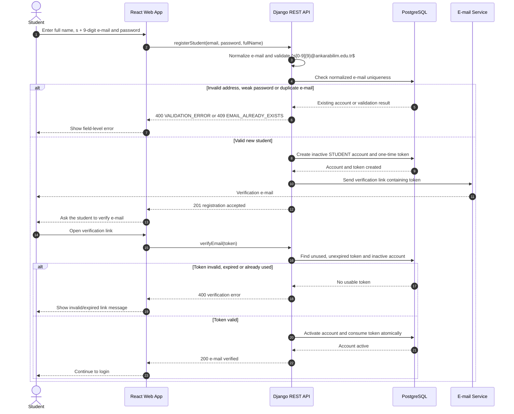
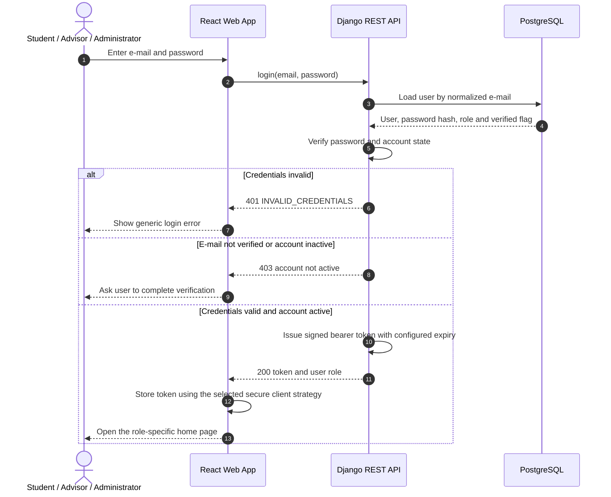
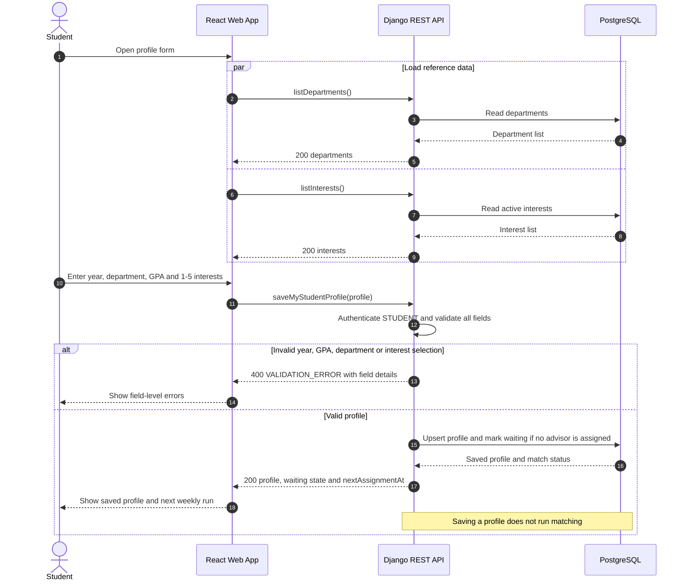
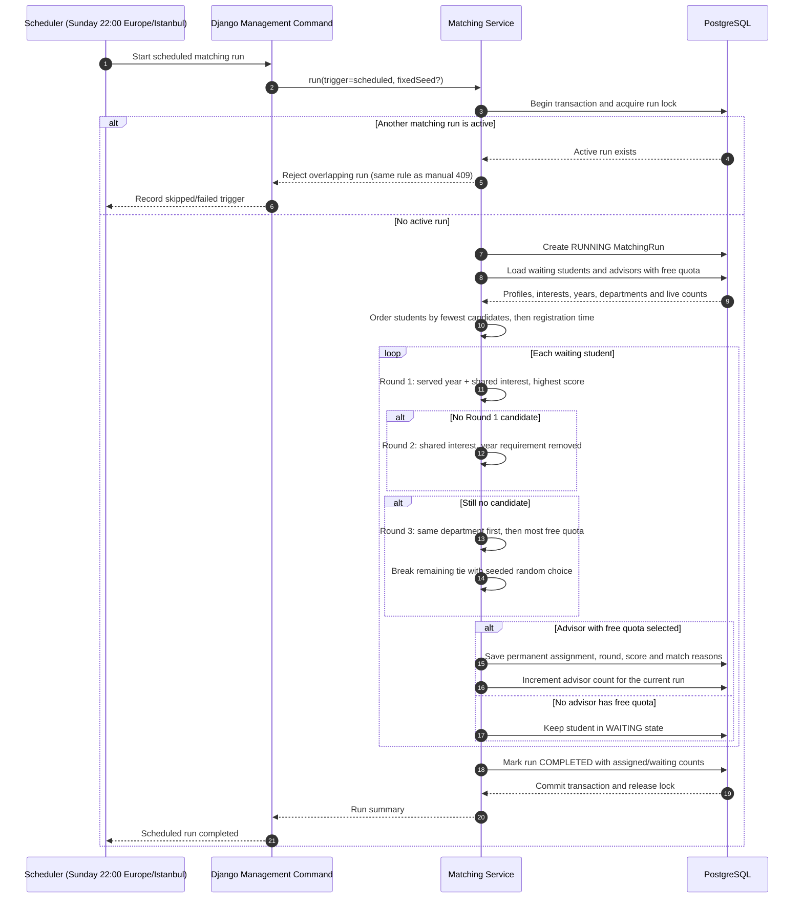

# Sequence Diagrams: Registration, Login and Matching

| Item | Value |
|---|---|
| Project | Career Advisor Matching and Appointment System (SENG 321, Team 8) |
| Sprint | Sprint 2 |
| Issue | #67 |
| Owner | Yağız (DevOps and CI/CD Infrastructure Engineer) |
| Reviewers | Ebrar and Fatima |
| Consulted | Fatima for matching |
| Sources | `docs/srs.md`, `openapi.yaml` v0.5.0 (#70), D-14, D-19 and D-20 |

These diagrams use the operation names and terms of OpenAPI v0.5.0. Authentication and profile requests pass through the Django REST API; weekly matching is an internal batch and never runs as a side effect of saving a profile.

## 1. Student registration and e-mail verification

The registration endpoint does not reveal or assign an advisor. Only addresses matching the institutional student pattern can self-register; advisor accounts are created by an administrator.

## 2. Login

All protected operations validate the bearer token and role. A valid token with the wrong role produces 403; a missing, invalid or expired token produces 401.

## 3. Student profile completion

Changes to the profile take effect in a later matching run. GPA is stored for the student and assigned advisor but is never used in the matching score.

## 4. Weekly advisor matching

An administrator can invoke `runMatchingNow`; it calls the same Matching Service with `trigger=manual`. A change-request approval uses `trigger=change_request` for one student and excludes the previous advisor. All paths share the same concurrency lock, scoring rules and persisted run history.

## 5. Traceability

| Flow | SRS requirements | OpenAPI/internal operations | Decisions |
|---|---|---|---|
| Registration and verification | FR-01 to FR-04 | `registerStudent`, `verifyEmail`, `resendVerification` | D-14, D-19 |
| Login | FR-05, FR-06 | `login`, bearer authentication | D-14, D-26 |
| Profile completion | FR-09 to FR-13 | `listDepartments`, `listInterests`, `saveMyStudentProfile` | D-23, D-25, D-26 |
| Weekly matching | FR-14 to FR-22 | Internal matching engine, `runMatchingNow`, `listMatchingRuns`, `getMyAdvisor` | D-17, D-20, D-24 |

The names in this document depend on the OpenAPI v0.5.0 alignment in #70 and the matching SRS terminology update in #57.
