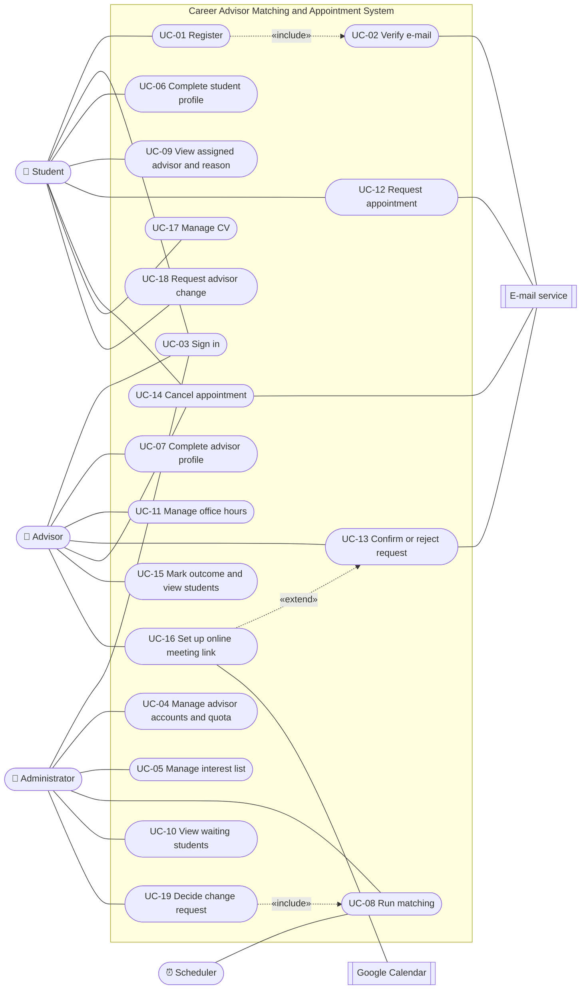

# Use Cases — Career Advisor Matching and Appointment System

| Field | Value |
|---|---|
| Deliverable | Sprint 2 — Use cases and coverage matrix |
| Team | Team 8 |
| Document owner (Accountable) | Aybüke BALÇIK — Product Owner |
| Contributor | Ebrar COMART — QA Engineer (alternative and exception flows) |
| Reviewer | Emine BARAN — Implementation Engineer |
| Related issue | #58 |
| Sources | `docs/srs.md` (FR-01 to FR-40), `docs/backlog.md`, `docs/decision.md` |

---

## 1. Actors

| Actor | Type | Description |
|---|---|---|
| Student | Primary | Registers with the student e-mail format, completes the profile, requests appointments, asks for an advisor change |
| Advisor | Primary | Faculty member; account created by the administrator; manages profile, office hours and appointments |
| Administrator | Primary | Manages advisors, quotas, the interest list, matching runs and change requests |
| Scheduler | Primary (time) | Starts the weekly matching run every Sunday at 22:00 (Europe/Istanbul) |
| E-mail service | Supporting | Delivers verification and appointment e-mails with .ics files |
| Google Calendar | Supporting | Creates and deletes calendar events with Meet links for connected advisors |

## 2. UML use case diagram

GitHub does not have a native UML use case notation in Mermaid, so the diagram uses the standard conventions as follows: actors are on the outside, use cases are rounded shapes inside the system boundary, solid lines are associations, and dashed arrows are `«include»` and `«extend»` relationships.

- UC-01 always includes sending and using the verification link (UC-02).
- UC-19 includes re-matching with the matching rules (UC-08) when a request is approved.
- UC-16 extends UC-13: when an online appointment is confirmed, a Meet link is created (or entered manually).

## 3. Use case list (brief)

| ID | Use case | Primary actor | Brief description | Priority |
|---|---|---|---|---|
| UC-01 | Register | Student | The student registers with an `s` + 9-digit `@ankarabilim.edu.tr` address and a password; the account is created inactive. | Must |
| UC-02 | Verify e-mail | Student, Advisor | The user opens the verification link and the account becomes active; a new link can be requested. | Must |
| UC-03 | Sign in | Student, Advisor, Administrator | A verified user signs in and sees the screens of the role. | Must |
| UC-04 | Manage advisor accounts and quota | Administrator | The admin creates advisor accounts (default quota 20) and changes quotas, never below the current student count. | Must |
| UC-05 | Manage interest list | Administrator | The admin adds, renames and deactivates interests and sets the maximum number per user. | Must |
| UC-06 | Complete student profile | Student | The student enters year, department, GPA and interests and waits for the next matching run. | Must |
| UC-07 | Complete advisor profile | Advisor | The advisor enters department, years served, interests, introduction and online preference. | Must |
| UC-08 | Run matching | Scheduler, Administrator | Waiting students are assigned to advisors in three rounds; the run is recorded. | Must |
| UC-09 | View assigned advisor and reason | Student | The student sees the advisor, the introduction and why they were matched, or the date of the next run. | Must |
| UC-10 | View waiting students | Administrator | The admin sees students who could not be matched. | Must |
| UC-11 | Manage office hours | Advisor | The advisor defines weekly recurring 30-minute slots and deletes free ones. | Must |
| UC-12 | Request appointment | Student | The student requests a free slot of the assigned advisor, in person or online. | Must |
| UC-13 | Confirm or reject request | Advisor | The advisor confirms or rejects a request; the student is e-mailed (with .ics when confirmed). | Must |
| UC-14 | Cancel appointment | Student, Advisor | Either side cancels with a reason, not within 30 minutes of the start. | Must |
| UC-15 | Mark outcome and view students | Advisor | The advisor marks a past appointment COMPLETED or NO_SHOW and views assigned students with GPA. | Must |
| UC-16 | Set up online meeting link | Advisor | The advisor connects Google Calendar for automatic Meet links or enters a link manually. | Should |
| UC-17 | Manage CV | Student (Advisor downloads) | The student uploads, replaces or deletes a PDF CV; the assigned advisor downloads it. | Should |
| UC-18 | Request advisor change | Student | The student sends a change request with a reason and an explanation. | Should |
| UC-19 | Decide change request | Administrator | The admin approves (re-matching) or rejects a pending change request with a note. | Should |

---

## 4. Fully dressed use cases

### UC-01 Register (includes UC-02 Verify e-mail)

| Field | Value |
|---|---|
| Primary actor | Student |
| Supporting actor | E-mail service |
| Stakeholders and interests | Student: quick access with the school e-mail. University: only students can self-register; advisor accounts stay under administrator control. |
| Preconditions | The person is not signed in. |
| Postconditions (success) | An active STUDENT account exists. |
| Trigger | The person selects "Register" on the home page. |
| Requirements | FR-01, FR-02, FR-03, FR-04, FR-05 |
| Stories | US-01, US-02, US-03 |

**Main success scenario**
1. The student enters full name, e-mail address and password.
2. The system checks that the address matches `s` + 9 digits `@ankarabilim.edu.tr`, is not registered yet, and that the password has at least 8 characters.
3. The system creates an inactive STUDENT account and sends a verification link through the e-mail service.
4. The system tells the student to check the inbox.
5. The student opens the link.
6. The system checks that the token is valid and unused, activates the account and shows the sign-in page.
7. The student signs in and is asked to complete the profile (UC-06).

**Alternative flows**
- **2a. Address in the advisor format** (first.last@…): the system rejects it (400) and explains that advisor accounts are created by the administrator.
- **2b. Other domain or wrong digit count** (e.g. 8 or 10 digits, look-alike domain): the system rejects it (400) and shows the expected format.
- **2c. Address already registered**: the system rejects it (409) and offers sign-in.
- **2d. Password shorter than 8 characters**: the system rejects it (400).
- **5a. The e-mail does not arrive**: the student requests a new link; repeated requests in a short time are refused (429).
- **6a. Expired or used token**: the system rejects it (400 or 409) and offers a new link; the account stays inactive.

**Exceptions**
- **3a. E-mail service unavailable**: the account is created, the failure is logged for retry and the student can request a new link later.

---

### UC-08 Run matching

| Field | Value |
|---|---|
| Primary actor | Scheduler (every Sunday 22:00); Administrator ("Run now") |
| Stakeholders and interests | Students: a suitable advisor. Advisors: a fair workload within their quota. Administrator: predictable, explainable results. |
| Preconditions | No other run is in progress. Students with saved profiles and no advisor are waiting for a match. |
| Postconditions (success) | Every waiting student with an available advisor is assigned; the others stay waiting; a run record is stored. |
| Trigger | Sunday 22:00 (Europe/Istanbul), or the administrator selects "Run now". |
| Requirements | FR-14 – FR-20, FR-22 |
| Stories | US-08, US-09, US-10, US-11, US-13 |

**Main success scenario**
1. The scheduler (or the administrator) starts a run; the system records the start time and the trigger.
2. The system collects the waiting students and the advisors with free quota.
3. The system orders the students: fewest candidate advisors first, then registration time.
4. For the next student, the system applies **Round 1**: among advisors who serve the student's year and share at least one interest, it takes the highest score (2 × shared interests + 1 same department + 1 year served); ties go to the advisor with fewer students.
5. The system assigns the advisor, stores the match reasons and increases that advisor's student count.
6. Steps 4–5 repeat until all students are processed.
7. The system stores the run result (assigned count, waiting count) and shows it in the run history.

**Alternative flows**
- **4a. No round-1 candidate**: the system applies **Round 2** with the year condition dropped (highest score, ties by fewer students).
- **4b. No round-2 candidate**: the system applies **Round 3**: interests are ignored and the advisor with the most free quota is chosen, preferring the student's department; ties are broken randomly (fixed seed in tests).
- **4c. No advisor with free quota**: the student stays waiting for a match and appears in the waiting list (UC-10); the student sees the date of the next run (UC-09).
- **1a. "Run now" while a run is in progress**: the system rejects the request (409).

**Exceptions**
- **1b. A non-administrator requests "Run now"**: the system rejects it (403).

**Business rules:** GPA is never used; an assignment is permanent; profile changes of advisors do not affect existing matches (FR-13).

---

### UC-12 Request appointment (with UC-13 Confirm or reject request)

| Field | Value |
|---|---|
| Primary actor | Student; Advisor (decision) |
| Supporting actors | E-mail service; Google Calendar (UC-16) |
| Stakeholders and interests | Student: a meeting without exchanging e-mails. Advisor: control of their own time. |
| Preconditions | The student is matched and has no active appointment; the advisor has office hours. |
| Postconditions (success) | The appointment is CONFIRMED, both sides are informed and the .ics file is available. |
| Trigger | The student selects "Request appointment" on the "My advisor" page. |
| Requirements | FR-24 – FR-27, FR-32, FR-33 |
| Stories | US-15, US-16, US-19, US-20 |

**Main success scenario**
1. The system shows the free future 30-minute slots of the assigned advisor.
2. The student chooses a slot and the meeting type (in person or online).
3. The system checks that the slot is free and the student has no active appointment, creates the appointment with status REQUESTED and e-mails the advisor.
4. The advisor opens the request and confirms it.
5. The system changes the status to CONFIRMED and e-mails the student with an .ics file; both sides can download the same file through "Add to calendar".
6. Both sides see the confirmed appointment in their lists.

**Alternative flows**
- **2a. Online chosen but the advisor does not offer online meetings**: the system rejects it (400).
- **3a. The slot has just been taken** (concurrent request): the system rejects it (409) and refreshes the free slots; exactly one of two concurrent requests succeeds.
- **3b. The student already has an active appointment**: the system rejects it (409).
- **4a. The advisor rejects the request**: the status becomes REJECTED, the slot is free again and the student is e-mailed; the student may request another slot.
- **5a. Online meeting**: UC-16 extends this step; if the advisor connected Google Calendar, a Meet link is created, otherwise the advisor enters a link.

**Exceptions**
- **3c. E-mail service unavailable**: the appointment is still created; the status is visible in the system and the e-mail is retried.
- **5b. Google Calendar error**: the appointment is still confirmed and the advisor is asked to enter a link manually.

---

### UC-19 Decide change request (after UC-18 Request advisor change)

| Field | Value |
|---|---|
| Primary actor | Administrator |
| Secondary actor | Student (UC-18) |
| Stakeholders and interests | Student: guidance that fits better. Previous advisor: informed of the change. Administrator: fair and recorded decisions. |
| Preconditions | The student sent a change request with a reason and an explanation of at least 20 characters (UC-18); the request is PENDING. |
| Postconditions (success) | The request is APPROVED or REJECTED with a note; on approval the student has a new advisor or keeps the current one if none is available. |
| Trigger | The administrator opens the change requests list. |
| Requirements | FR-37, FR-38, FR-39, FR-40 |
| Stories | US-25, US-26 |

**Main success scenario**
1. The system lists the PENDING requests with student, current advisor, reason and explanation (visible only to administrators and the student).
2. The administrator chooses a request, writes a note and approves it.
3. The system re-matches the student with the matching rules (UC-08), excluding the previous advisor.
4. The system assigns the new advisor, cancels future appointments with the previous advisor and e-mails the previous advisor and the student.
5. The system stores the decision, the note and the result; the student sees the new advisor and the reason (UC-09).

**Alternative flows**
- **2a. The administrator rejects the request**: a note is required (400 without a note); the student keeps the current advisor and sees the decision.
- **3a. No other advisor has free quota**: the student keeps the current advisor and the request records that no alternative was found.

**Exceptions**
- **2b. The request is no longer PENDING** (already decided): the system rejects the decision (409).
- **UC-18 1a. The student already has a PENDING request**: a new request is rejected (409).
- **UC-18 1b. Explanation shorter than 20 characters**: the request is rejected (400).

---

## 5. Coverage matrix: functional requirements → use cases

Every functional requirement in `docs/srs.md` appears at least once.

| FR | Use case(s) | FR | Use case(s) |
|---|---|---|---|
| FR-01 | UC-01 | FR-21 | UC-09 |
| FR-02 | UC-01 | FR-22 | UC-10, UC-08 |
| FR-03 | UC-01, UC-02 | FR-23 | UC-11 |
| FR-04 | UC-02 | FR-24 | UC-12 |
| FR-05 | UC-03 | FR-25 | UC-12 |
| FR-06 | all (role and ownership checks) | FR-26 | UC-12 |
| FR-07 | UC-04 | FR-27 | UC-13 |
| FR-08 | UC-04 | FR-28 | UC-14 |
| FR-09 | UC-05 | FR-29 | UC-14 |
| FR-10 | UC-05 | FR-30 | UC-15 |
| FR-11 | UC-06 | FR-31 | UC-15 |
| FR-12 | UC-07 | FR-32 | UC-01, UC-12, UC-13, UC-14 |
| FR-13 | UC-07, UC-08 | FR-33 | UC-13 |
| FR-14 | UC-08 | FR-34 | UC-16 |
| FR-15 | UC-08 | FR-35 | UC-16 |
| FR-16 | UC-08 | FR-36 | UC-17 |
| FR-17 | UC-08 | FR-37 | UC-18 |
| FR-18 | UC-08 | FR-38 | UC-19 |
| FR-19 | UC-08 | FR-39 | UC-18 |
| FR-20 | UC-08 | FR-40 | UC-15, UC-17, UC-19 |

## 6. Use cases → stories and API operations

| Use case | Stories | API operations (`openapi.yaml`) |
|---|---|---|
| UC-01 Register | US-01 | `registerStudent` |
| UC-02 Verify e-mail | US-02 | `verifyEmail`, `resendVerification` |
| UC-03 Sign in | US-03 | `login` |
| UC-04 Manage advisor accounts and quota | US-05 | `listAdvisors`, `createAdvisorAccount`, `updateAdvisorCapacity` |
| UC-05 Manage interest list | US-04 | `listKeywords`, `createKeyword`, `updateKeyword` |
| UC-06 Complete student profile | US-06 | `listDepartments`, `getMyStudentProfile`, `saveMyStudentProfile` |
| UC-07 Complete advisor profile | US-07 | `getMyAdvisorProfile`, `saveMyAdvisorProfile` |
| UC-08 Run matching | US-08 – US-11 | `runMatchingNow`, `listMatchingRuns` (scheduled run is internal) |
| UC-09 View assigned advisor and reason | US-12 | `getMyAdvisor` |
| UC-10 View waiting students | US-13 | `listWaitingStudents` |
| UC-11 Manage office hours | US-14 | `listMyOfficeHours`, `createOfficeHours`, `deleteOfficeHourSlot` |
| UC-12 Request appointment | US-15 | `listAdvisorOfficeHours`, `requestAppointment`, `getAppointment` |
| UC-13 Confirm or reject request | US-16, US-20 | `confirmAppointment`, `rejectAppointment`, `downloadAppointmentCalendar` |
| UC-14 Cancel appointment | US-17 | `cancelAppointment` |
| UC-15 Mark outcome and view students | US-18 | `listAppointments`, `markAppointmentOutcome`, `listMyStudents` |
| UC-16 Set up online meeting link | US-21, US-22 | `getGoogleCalendarStatus`, `startGoogleCalendarConnect`, `completeGoogleCalendarConnect`, `disconnectGoogleCalendar`; manual link operation to be added (#70) |
| UC-17 Manage CV | US-23, US-24 | `uploadMyCv`, `downloadMyCv`, `deleteMyCv`, `downloadStudentCv` |
| UC-18 Request advisor change | US-25 | `createAdvisorChangeRequest`, `listAdvisorChangeRequests` |
| UC-19 Decide change request | US-26 | `decideAdvisorChangeRequest` |
