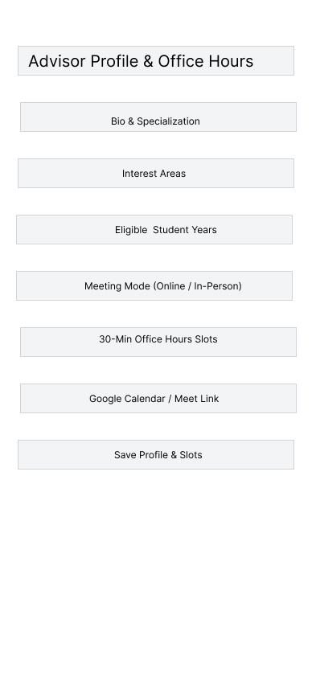

# Advisor and Administrator Screens

Figma design file: https://www.figma.com/design/YWPkjTqH5NflMmNDhqw4uu/Untitled?node-id=0-1&t=FJpGnegomFfEfPso-1

Each screen is designed for two sizes:

| Device | Frame size |
| :--- | :--- |
| Desktop | 1440 x 1024 px |
| Phone (iPhone 14 & 15 Pro) | 393 x 852 px |

The screens follow the advisor and administrator flows in [user-flows.md](user-flows.md) and align with system rules and API endpoints.

## Advisor Screens

### 1. Advisor Login, Profile, and Office Hours
Advisors sign in with their administrator-created account and manage their profile including `bio`, `interests`, `years served`, and `online preference` (per-advisor preference)[cite: 11]. Advisors add recurring 30-minute office hour slots, delete free slots, optionally connect Google Calendar for automatic Google Meet links (or enter a meeting link manually), and view incoming appointment requests[cite: 11].

### Desktop (1440x1024)

### Mobile (393x852)

### 2. Appointment Requests, Schedule, and Post-Meeting Outcomes
Advisors review appointment requests (`REQUESTED`) and either confirm (`CONFIRMED`, triggering `.ics` delivery and automatic Google Meet link when Google Calendar is connected, or manual link entry) or reject (`REJECTED`) them[cite: 11]. Advisors can cancel an appointment with a reason more than 30 minutes before the start time (`> 30 minutes` lock applies to both students and advisors; cancellations within 30 minutes are blocked)[cite: 11]. After a session takes place, the advisor marks the post-meeting outcome as `COMPLETED` or `NO_SHOW` (rather than treating `CONFIRMED` as a final outcome) and views assigned advisees and their GPA[cite: 11].

### Desktop (1440x1024)

### Mobile (393x852)

### 3. Assigned Advisees and Student CVs
Advisors view the students assigned to them and download uploaded student CVs (PDF).

### Desktop (1440x1024)

### Mobile (393x852)

## Administrator Screens

### 4. Advisor Quotas, Waiting Students, and Matching Runs
Administrators create advisor accounts with a default quota of `20` and update advisor quotas without setting a quota below the current assigned student count[cite: 10]. Administrators view students waiting for a match, trigger matching manually ("Run matching now"), and inspect matching run history[cite: 10].

### Desktop (1440x1024)

### Mobile (393x852)

### 5. Advisor Change Requests
Administrators review pending advisor change requests[cite: 10]. The written explanation is visible only to the student and the administrator. When approving a request, the system re-matches the student excluding the previous advisor (keeping the current advisor if no alternative is available)[cite: 10]. When rejecting a request, a written reason is required[cite: 10].

### 6. Advisor Accounts and Interest List Management
Administrators manage advisor accounts (adding and deactivating accounts) and manage the interest list (adding, renaming, and deactivating interests)[cite: 10].
