# Advisor and Administrator Screens

Figma design file: [Advisor and Administrator Screens](https://www.figma.com/design/YWPkjTqH5NflMmNDhqw4uu/Advisor-and-Administrator-Screens?node-id=0-1&t=NmPhA2VEReo0FdlC-1)

Each screen is designed for two sizes:

| Device | Frame size |
| :--- | :--- |
| Desktop | 1440 x 1024 px |
| Phone (iPhone 14 & 15 Pro) | 393 x 852 px |

The screens follow the advisor and administrator flows in [user-flows.md](user-flows.md) and use the same layout as the [student screens](student-screens.md). Each screen lists the requirements (SRS), stories (backlog) and API operations (`openapi.yaml`) it covers; the full matrix is in [`docs/traceability.md`](../traceability.md). Names and numbers on the screens are sample data.

Navigation:
- Advisor: **Profile | Requests | Advisees**
- Administrator: **Quotas & Matching | Interests | Change Requests | Accounts**

## Advisor Screens

### A1. Profile and Office Hours
| Requirements | Stories | API operations |
|---|---|---|
| FR-12, FR-13, FR-23, FR-34, FR-35 | US-07, US-14, US-21, US-22 | `saveMyAdvisorProfile`, `createOfficeHour`, `deleteOfficeHour`, `startGoogleCalendarConnect` |

The advisor edits the short introduction, the student years served, the meeting mode (online and/or in person) and the interests (at least 1, at most 5). Weekly office hours are entered as 30-minute slots. **Connect Google Calendar** enables automatic Google Meet links; if it is not connected, the advisor adds a meeting link when approving a request.

#### Desktop (1440x1024)
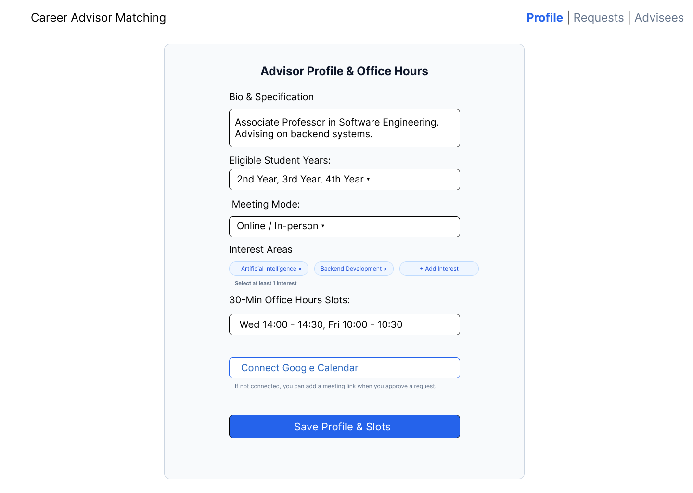

#### Mobile (393x852)

### A2. Requests and Schedule
| Requirements | Stories | API operations |
|---|---|---|
| FR-27, FR-28, FR-29, FR-30, FR-35 | US-16, US-17, US-18, US-22 | `confirmAppointment`, `rejectAppointment`, `cancelAppointment`, `markAppointmentOutcome` |

**Incoming Requests** lists `REQUESTED` appointments with **Approve** (→ `CONFIRMED`, `.ics` e-mail, Meet link) and **Reject** (→ `REJECTED`). **Scheduled Appointments** lists confirmed meetings with the Meet link or the room. After the start time the advisor marks **Completed** or **No-Show**.

States shown:
- **Cancel** requires a written reason ("Reason for cancellation (required)", FR-28).
- Within 30 minutes of the start, the button is disabled and reads **Cancel locked (< 30 min)** (FR-29, API 409 `CANCELLATION_WINDOW_CLOSED`).

#### Desktop (1440x1024)
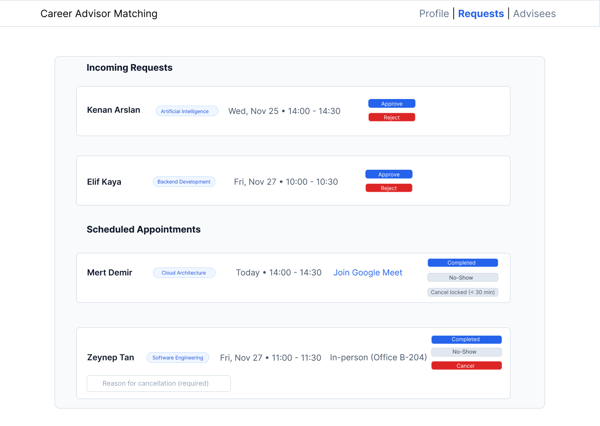

#### Mobile (393x852)
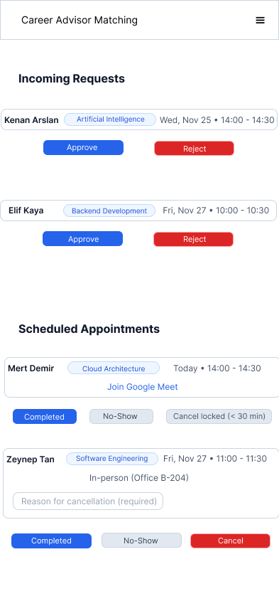

### A3. Assigned Advisees and Student CVs
| Requirements | Stories | API operations |
|---|---|---|
| FR-31, FR-36, FR-40 | US-18, US-24 | `listMyStudents`, `downloadStudentCv` |

The advisor sees the assigned students with their school e-mail and interests, previews a CV (year and GPA are visible only to the assigned advisor) and downloads it as PDF.

#### Desktop (1440x1024)
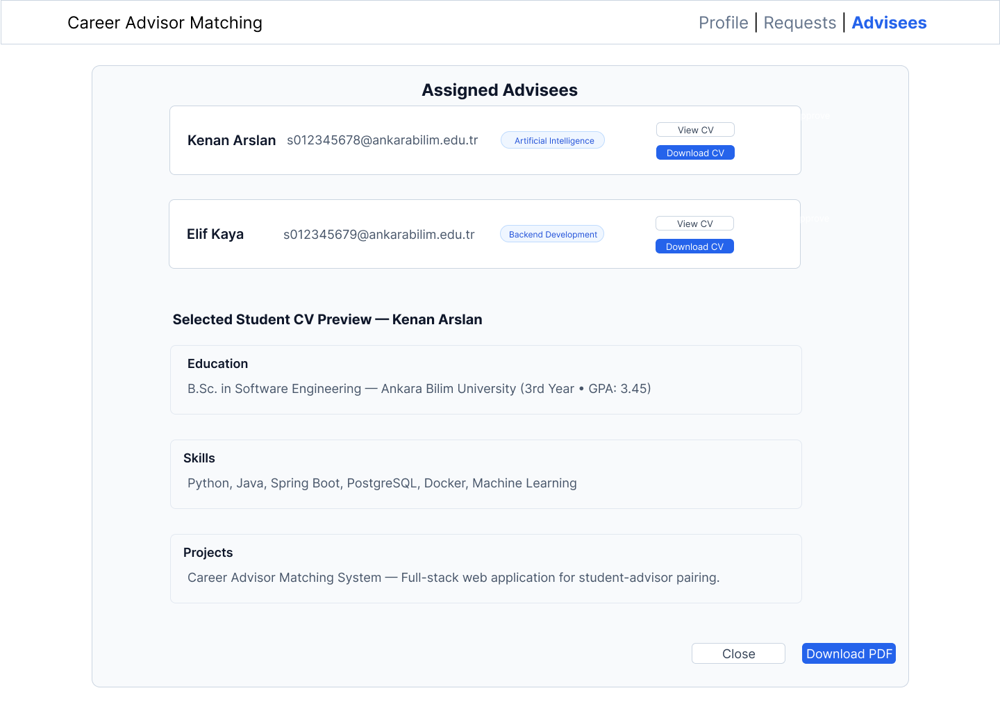

#### Mobile (393x852)
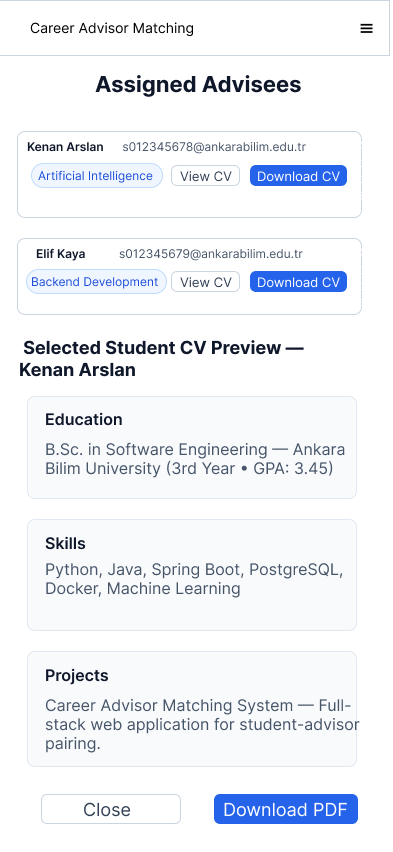

## Administrator Screens

### B1. Quotas and Matching
| Requirements | Stories | API operations |
|---|---|---|
| FR-08, FR-14, FR-20, FR-22 | US-05, US-11, US-13 | `listAdvisors`, `updateAdvisorQuota`, `listWaitingStudents`, `runMatchingNow` |

The administrator sees each advisor's students / quota and edits the quota (a quota below the current number of students is rejected, API 409). Students who could not be matched are listed as **Waiting**. Matching is automatic: the weekly run is shown as **Next scheduled run: Sunday 22:00**, and **Run Matching Now** starts the same 3-round matching immediately. There is no manual assignment of a student to an advisor (FR-16).

#### Desktop (1440x1024)
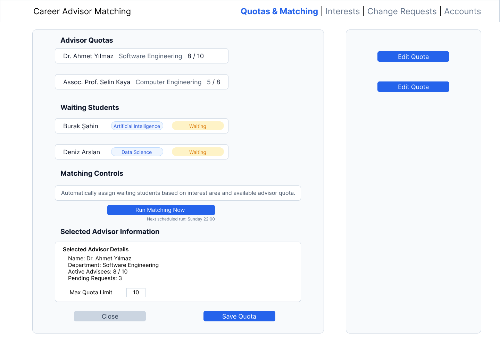

#### Mobile (393x852)
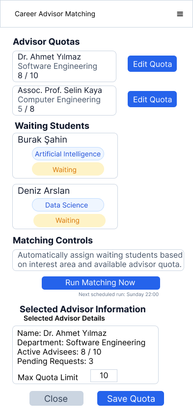

### B2. Advisor Change Requests
| Requirements | Stories | API operations |
|---|---|---|
| FR-38, FR-40 | US-26 | `listAdvisorChangeRequests`, `decideAdvisorChangeRequest` |

The administrator reviews a pending request with the reason and the explanation (visible only to the student and administrators), writes a note and approves or rejects it. On approval the student is re-matched without the previous advisor and future appointments with the previous advisor are cancelled; if no other advisor has free quota, the student keeps the current advisor (D-21).

#### Desktop (1440x1024)
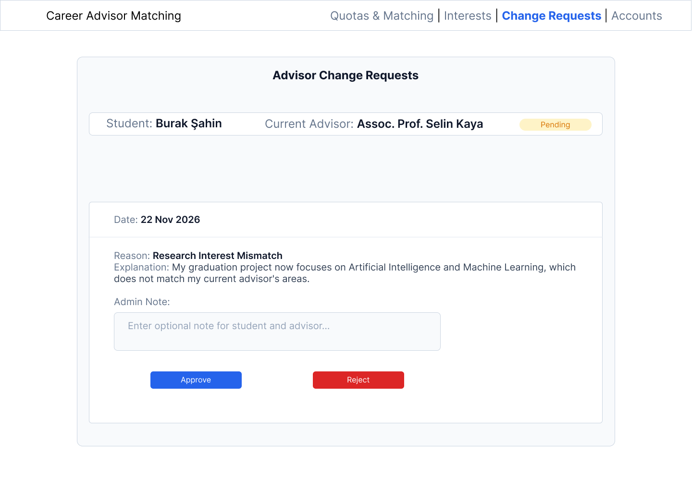

#### Mobile (393x852)
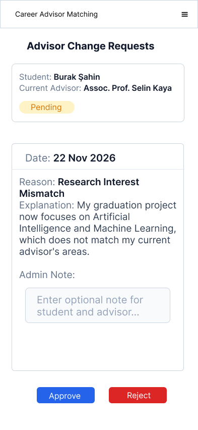

### B3. Interest List
| Requirements | Stories | API operations |
|---|---|---|
| FR-09, FR-10 | US-04 | `listInterests`, `createInterest`, `updateInterest` |

The administrator adds, renames, deactivates and reactivates interests. The limit of **5 interests per person** (D-25) is shown at the top. A deactivated interest is not offered for new selections.

#### Desktop (1440x1024)
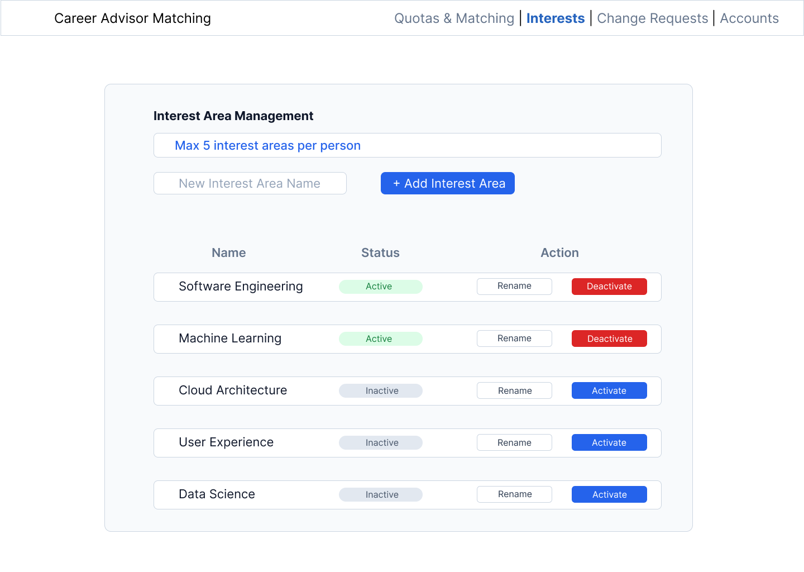

#### Mobile (393x852)
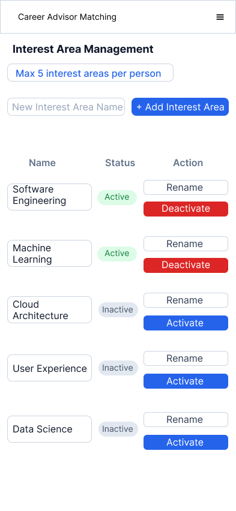

### B4. Advisor Accounts
| Requirements | Stories | API operations |
|---|---|---|
| FR-07, FR-08 | US-05 | `createAdvisorAccount`, `listAdvisors` |

The administrator creates an advisor account with full name, school e-mail (`first.last@ankarabilim.edu.tr`), department and quota (default 20); a verification e-mail is sent. The list shows each advisor's department, students / quota and status (**Active** or **Verification pending**). Students are not created here; they register themselves.

#### Desktop (1440x1024)
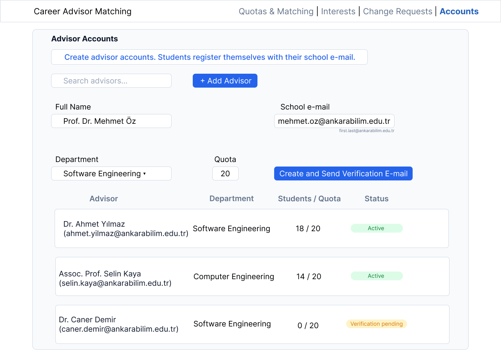

#### Mobile (393x852)
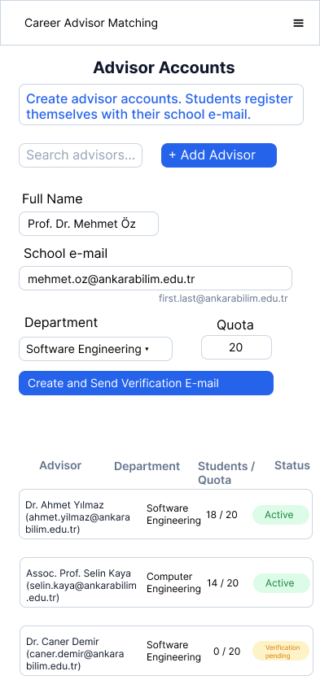
