# Student Screens

Figma design file: [Career Advisor Matching – Student Screens](https://www.figma.com/design/4EBRTQr6qI3nCYrgwtjXFN/Career-Advisor-Matching---Screens?node-id=0-1&t=FTJWB3RPnHpztpoo-1)

Each screen is designed for two sizes:

| Device | Frame size |
|---|---|
| Desktop | 1440 x 1024 px |
| Phone (iPhone 14 & 15 Pro) | 393 x 852 px |

The screens follow the student flow in [user-flows.md](user-flows.md).

## 1. Log in and register

Students log in with the school email (s + 9 digits, for example s123456789@ankarabilim.edu.tr). New students switch to Register and click the verification link sent to their inbox.

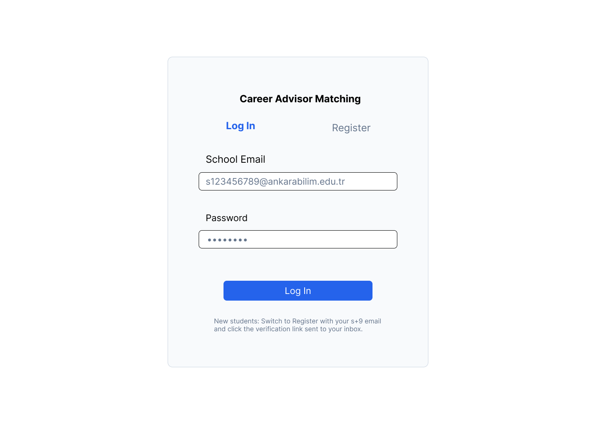
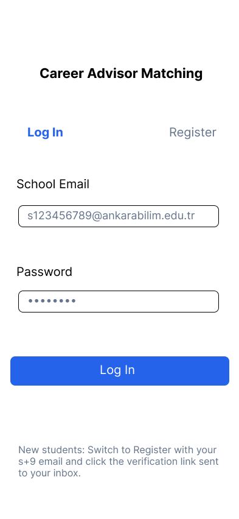

Registration with name, school email and password (minimum 8 characters). A verification link is sent to the email.

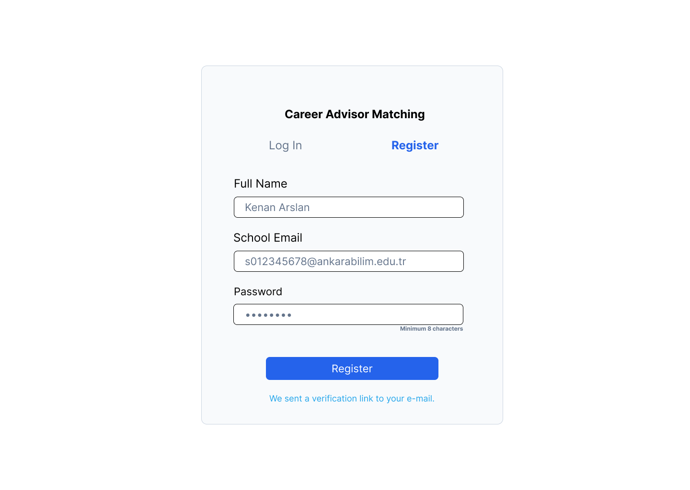
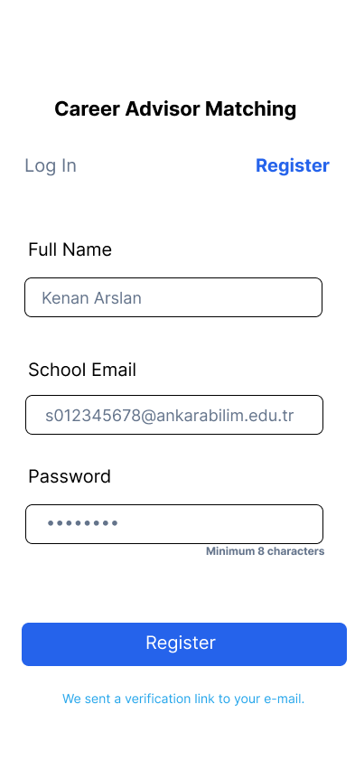

## 2. Student profile

The student enters year, department, GPA and at least one interest, and can upload a CV (PDF, max 2 MB, optional). The profile is used for the weekly advisor matching.

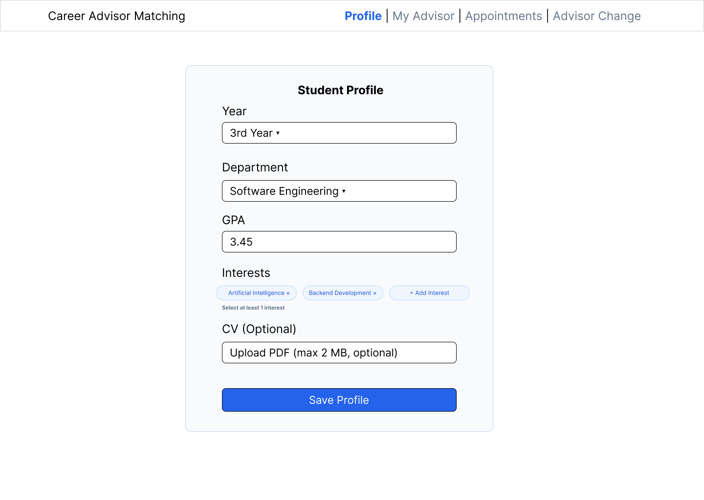
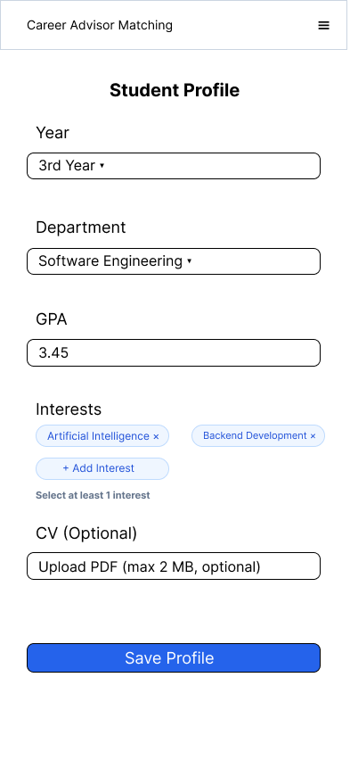

## 3. My advisor

The student sees the assigned advisor, the reason for the match and the weekly assignment time (Sunday 22:00). From this screen the student can request an appointment or an advisor change.

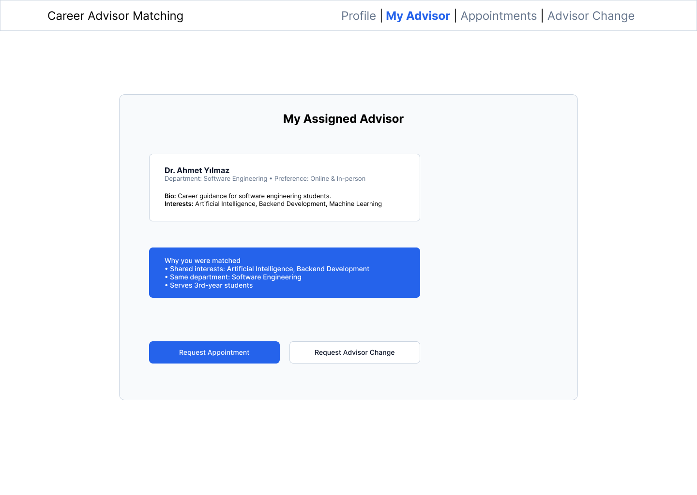
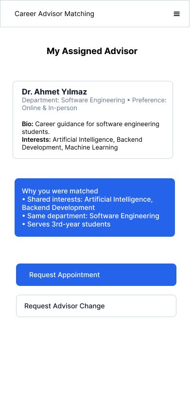

Before the first matching run, the student sees a waiting message with the time of the next run.

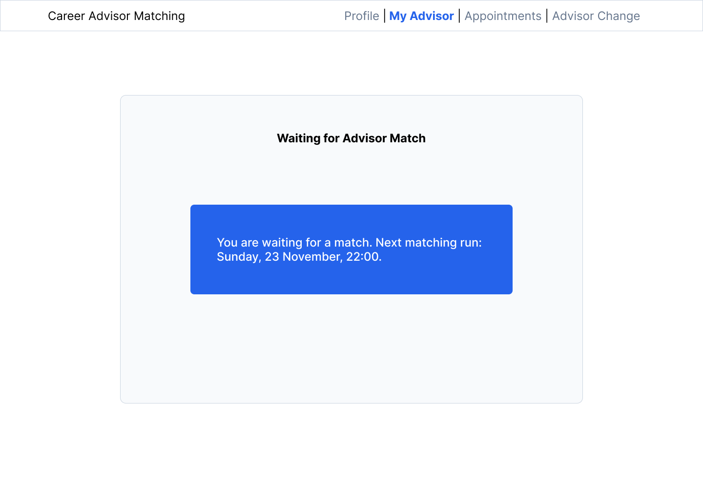
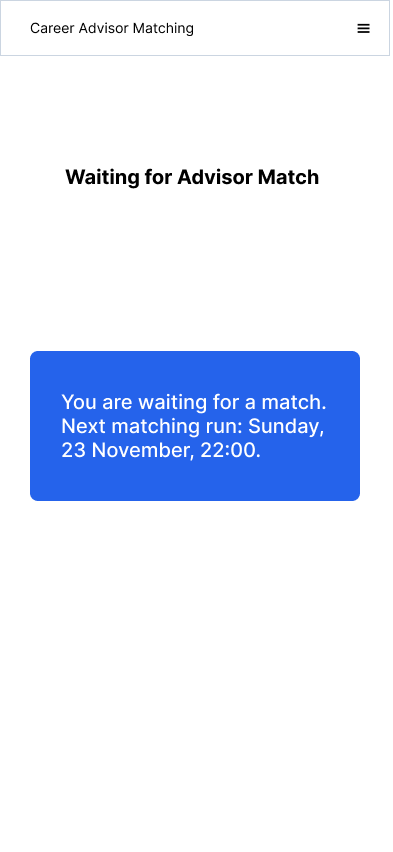

## 4. Appointments

The student requests an appointment from the advisor's office hours and chooses online or in-person. Only one active appointment is allowed at a time (FR-26), so the request form is disabled while an active appointment exists. The list shows the active appointment alongside past appointments (`COMPLETED`, `CANCELLED`, `REJECTED`). Confirmed appointments include a calendar file (`.ics`), and cancellation is locked 30 minutes before the meeting.

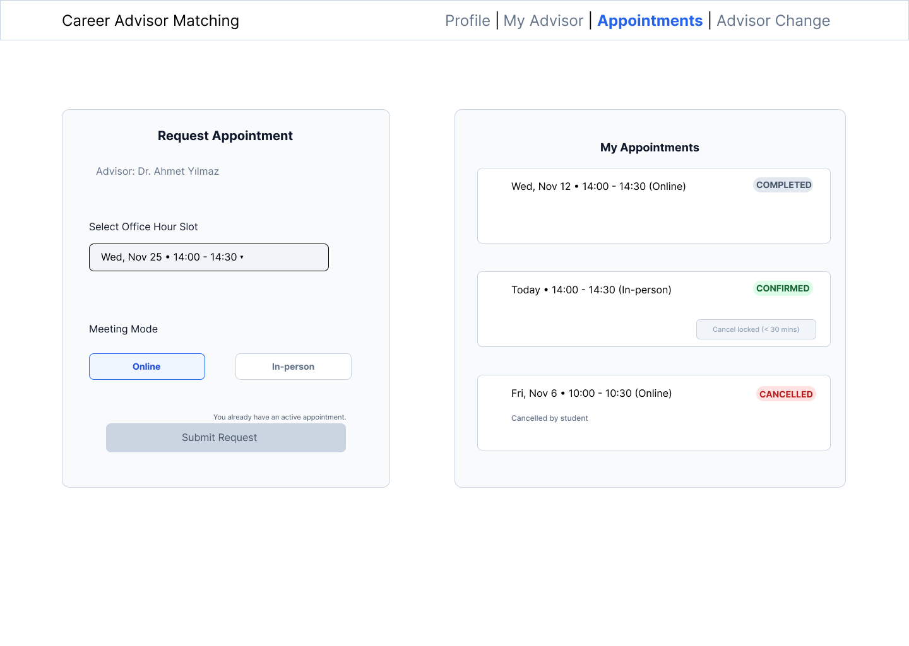
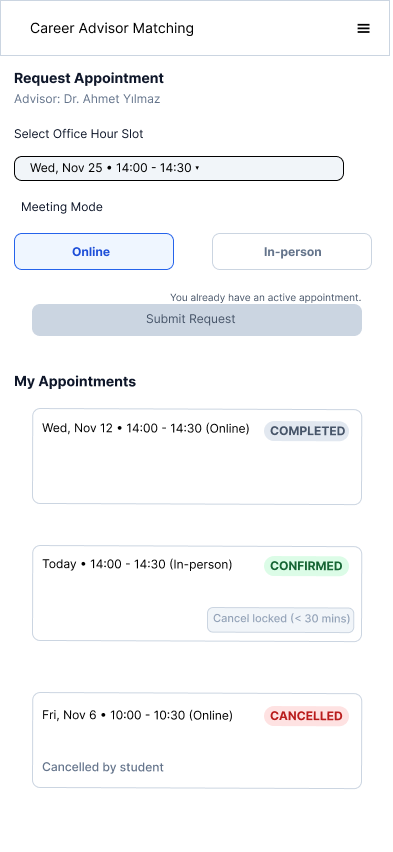

## 5. Advisor change request

The student selects a reason (Time conflict, Field mismatch, Communication issue, Year change or Other), writes an explanation of at least 20 characters and sends the request to the administrator. Only one pending request is allowed at a time. If the request is approved, the student is matched again and the previous advisor is excluded.

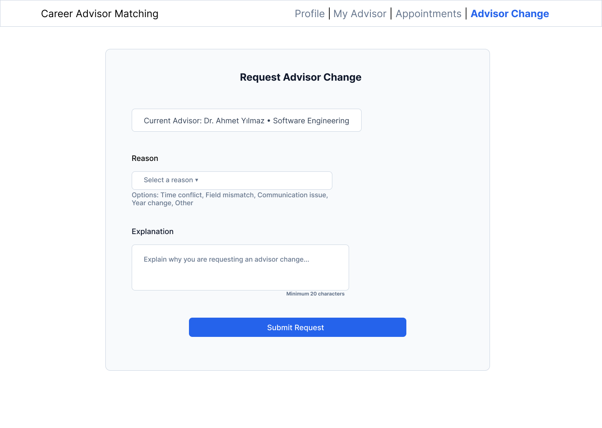
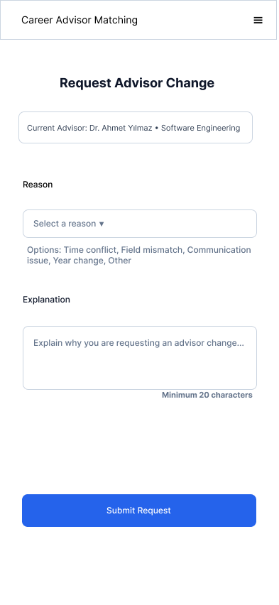

After sending, the request shows as pending.

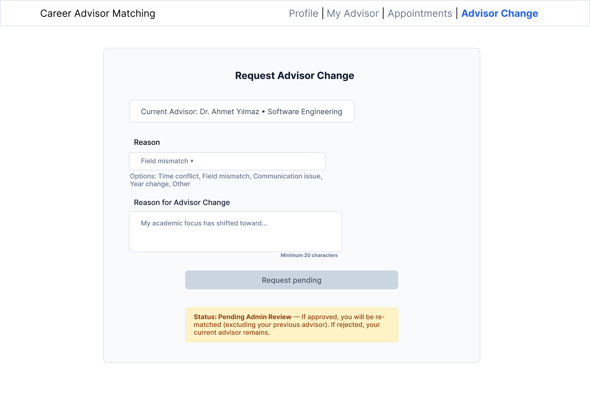
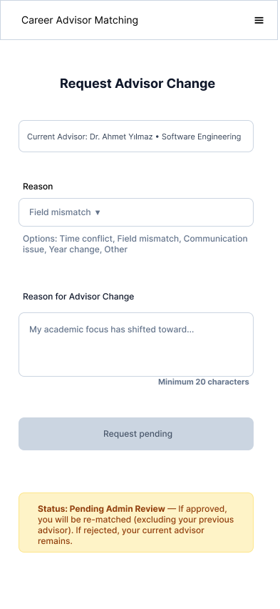
