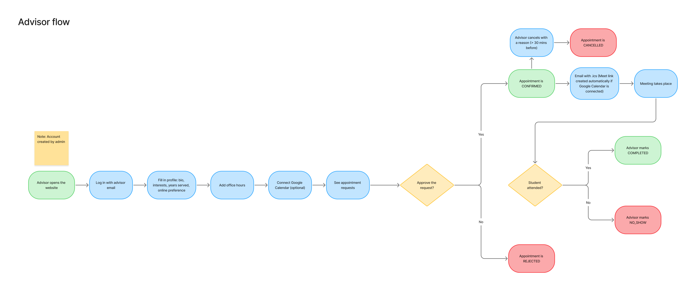
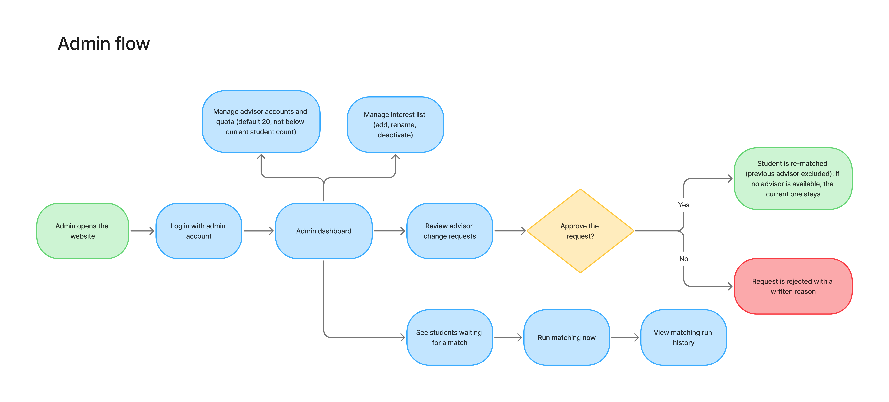

# User Flow Diagrams

- **Figma (FigJam) Link:** [Career Advisor Matching - User Flows](https://www.figma.com/board/yCbRs4vPk9B99bneEDwANZ/Career-Advisor-Matching---User-Flows?node-id=0-1&t=FTJWB3RPnHpztpoo-1)
- **Related Issue:** #62

## 1. Student User Flow
Covers website entry, authentication (`s+9` student email), profile setup (year, department, GPA, interests; CV optional), weekly Sunday 22:00 matching result with match explanation, appointment request, 30-minute cancellation rule, and advisor change request.

## 2. Advisor User Flow
Covers advisor login, profile and weekly office hours setup, reviewing appointment requests (`CONFIRMED` / `REJECTED`), post-meeting attendance recording (`COMPLETED` / `NO_SHOW`), and the 30-minute cancellation rule (`CANCELLED`).

## 3. Administrator User Flow
Covers admin login, configuring advisor capacities (default: 20), managing interest lists, monitoring/running the weekly 3-round matching batch, and approving/rejecting student advisor-change requests.

