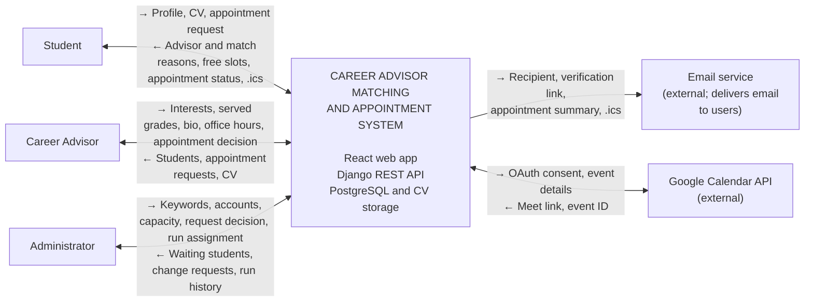

<!--
  This file is shared by two people in Sprint 1 (Rule 6).
  The System Boundary part (Fatima, #15) is merged first.
  The "Vision" section is added by Aybüke after this PR is merged.
-->

# System Vision and Boundary

## Vision

> **For** Ankara Science University students who need career guidance and the
> faculty members who advise them, the **Career Advisor Matching and
> Appointment System** is a responsive web application that **assigns each
> student a permanent career advisor through a transparent, rule-based weekly
> matching run** and lets the student **request that advisor's office hours
> directly**. Unlike informal e-mail and word-of-mouth arrangements, the system
> shows students why they were matched, gives advisors control over their
> requests and meeting type, prevents double bookings, and keeps both sides
> informed by e-mail with a calendar file.
>
> The first release supports three roles — student, advisor and administrator.
> It covers registration with an institutional e-mail address and e-mail
> verification, student and advisor profiles, weekly three-round matching,
> office-hour requests with advisor approval and cancellation, in-person or
> online meetings (with automatic Google Meet links for advisors who connect
> Google Calendar), e-mail notifications with .ics files, CV upload for the
> assigned advisor, and advisor change requests decided by an administrator.
> A native mobile application, own video infrastructure and AI-based matching
> are outside the first release.

## System Boundary

This section shows what is inside the **Career Advisor Matching and
Appointment System**, what is outside it, and which information it shares
with external systems and for what purpose.

### Boundary diagram

How to read it: arrows are two-way. `→` is information flowing left to right
and `←` is information flowing right to left. For the users in the left
column `→` means information entering the system. For the external services in
the right column `→` means information leaving the system toward the service.

### Relationships: what information, for what purpose

| # | Direction | Information | Purpose |
|---|---|---|---|
| 1 | Student → System | Registration data, profile (grade, department, GPA, 1-5 keywords), CV (PDF, at most 2 MB), appointment request and cancellation, advisor change request | To get an advisor assignment and book appointments |
| 2 | System → Student | Assigned advisor with bio, why they were matched, next assignment date, free office hours, appointment status, meeting link, calendar file (.ics) | So the student sees their advisor and appointment and can add it to a calendar |
| 3 | Advisor → System | Interest keywords, served grades, short bio, online-meeting preference, office hours, appointment accept/reject/cancel decision, meeting link, Google account consent | To be eligible for matching and to manage appointments |
| 4 | System → Advisor | Students (including GPA, shown as information only), appointment requests, student's CV | To prepare for meetings and decide on requests |
| 5 | Administrator → System | Keyword list (add, rename, deactivate), advisor accounts, capacity, change-request decision and reason, manual assignment run | To manage the system |
| 6 | System → Administrator | Students waiting for a match, change requests (with explanation), assignment run history | To decide and to notice unmatched students |
| 7 | System → Email service | Recipient address, verification link, appointment summary, .ics attachment | To send verification and notification e-mails |
| 8 | Email service → Users | Delivery of the e-mail (verification, request, confirmation, cancellation) | To inform users (happens outside the system) |
| 9 | System → Google Calendar API | Advisor's OAuth consent, event details (title, time, attendee e-mail) | To create a Meet link for a confirmed online appointment |
| 10 | Google Calendar API → System | Google Meet link, event ID | To attach the link to the appointment and delete the event on cancellation |

### Responsibilities of the system (first release)

- Student registration, `@ankarabilim.edu.tr` e-mail verification, and role
  assignment from the e-mail format (student: `s` + 9 digits; advisor accounts
  are created only by an administrator)
- Student profile (grade, department, GPA, 1-5 keywords from a predefined
  list; the maximum is configurable)
- Advisor profile: interest keywords, served grades, short self-introduction,
  online-meeting preference, office hours (30-minute slots)
- Rule-based advisor matching (no AI), run **weekly (every Sunday 22:00,
  Europe/Istanbul)** or manually by an administrator; students who cannot be
  matched are shown to the administrator
- Showing each student **why** they were matched and when the next assignment
  runs
- Appointment request → advisor confirmation or rejection → cancellation with a
  reason (not allowed within 30 minutes of the start); one booking per slot,
  one active appointment per student
- Hybrid meetings: online or in person. Online meetings depend on the
  advisor's preference; with a connected Google account a Google Meet link is
  created automatically, otherwise a Zoom/Meet/Teams link is entered by hand
- E-mail notifications and an add-to-calendar file (.ics)
- CV upload (PDF, at most 2 MB; visible only to the student and the assigned
  advisor)
- Advisor change request (including the optional `grade_change` reason) and
  administrator decision
- Administrator functions: keyword list, advisor accounts, advisor capacity
  (new advisors start at 20)

### Out of scope or postponed

| Topic | Status | Reason |
|---|---|---|
| Own video-meeting infrastructure | Out of scope | Only external links are used; no video system is built |
| AI-based matching | Out of scope | Matching is rule-based |
| Mobile app (iOS/Android) | Postponed | The first release is a mobile-friendly web app |
| University SSO / identity integration | Out of scope | Identity comes from the school e-mail and the verification link |
| Automatic Zoom and Teams link creation | Postponed | Only Google Meet is automatic; others are entered by hand |
| Appointment reminders and auto-cancelling expired requests | Decision pending (Aybüke) | Not decided yet |
| Instant matching when a profile is saved | Out of scope | Matching runs in a weekly batch |

### Users and external systems

| Party | Part of the system? | Role |
|---|---|---|
| Student, Career Advisor, Administrator | No (users) | Use the web app |
| Email service | No (external service) | Delivers verification and notification e-mails; the system needs it to work |
| Google Calendar API | No (external service) | Creates a Meet link only if the advisor connects their account; if not connected, the system works with a manually entered link |

## Constraints

- **Domain:** only `@ankarabilim.edu.tr` addresses can register. Student
  addresses are `s` + 9 digits (e.g. `s230205030@ankarabilim.edu.tr`); advisor
  addresses are `name.surname` or `n.surname`.
- **Technology:** Python/Django REST Framework and PostgreSQL on the back end;
  React web front end; the contract is `openapi.yaml`.
- **Matching:** rule-based only, run weekly (Sunday 22:00 Europe/Istanbul);
  students are processed fewest-options-first, then by registration time.
  GPA is not used in the score.
- **Appointments:** fixed 30-minute length; no cancellation within 30 minutes
  of the start; one booking per slot; one active appointment per student.
- **Capacity:** set by the administrator; new advisors start at 20; it cannot
  be set below the current student count.
- **CV files:** PDF only, at most 2 MB.
- **Interest areas:** a predefined list managed by the administrator; at least
  1 and currently at most 5 per user (the limit and the first list are to be
  finalized with advisors).
- **Language:** all project documents are written in English.
- **Time zone:** all times are Europe/Istanbul.
- **Delivery:** the course schedule (Sprint 1 due 3 November 2026) and a
  six-person team.

## Assumptions

- The `@ankarabilim.edu.tr` domain and the e-mail verification link are enough
  proof of university membership; an account is not active until the link is
  used.
- The role is derived from the e-mail format, but advisor accounts are created
  only by an administrator; a student cannot make themselves an advisor.
- Administrator accounts are trusted and added by hand.
- Only the student and the assigned advisor can see the GPA; only the student
  and administrators can see the explanation in an advisor change request; only
  the student and the assigned advisor can download the CV.
- The advisor's Google authorization belongs to the advisor and can be removed
  at any time. If it is removed, the system goes back to entering links by
  hand.
- If an advisor changes their profile, the assignments of current students do
  not change.
- When a student moves up a grade, the assignment does not change
  automatically; the student may optionally send a change request.
- E-mail delivery is not guaranteed, so important information (appointment
  status) is also shown in the system.
