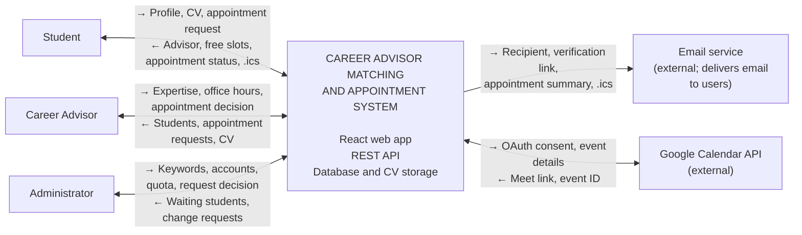

<!--
  Bu dosya Sprint 1'de iki kişinin ortak dosyasıdır (Kural 6).
  Önce sistem sınırı bölümü (Fatima, #15) merge edilir.
  "Vizyon" bölümü bu PR merge olduktan sonra Aybüke tarafından eklenir.
-->

# Vizyon ve Sistem Sınırı

## Sistem Sınırı

Bu bölüm, **Kariyer Danışmanlığı Eşleştirme ve Randevu Sistemi**'nin neyin
içinde olduğunu, neyin dışında kaldığını ve dış sistemlerle hangi bilgiyi
hangi amaçla paylaştığını gösterir.

### Sınır diyagramı

Okuma kuralı: oklar iki yönlüdür. `→` soldan sağa, `←` sağdan sola akan
bilgiyi gösterir. Sol sütundaki kullanıcılar için `→` bilginin sisteme
girdiğini, sağ sütundaki dış servisler için `→` sistemden servise çıktığını
anlatır.

### İlişkiler: hangi bilgi, hangi amaç

| # | Yön | Bilgi | Amaç |
|---|---|---|---|
| 1 | Öğrenci → Sistem | Kayıt bilgisi, profil (sınıf, bölüm, GNO, 1-5 anahtar kelime), CV (PDF, en fazla 2 MB), randevu talebi ve iptali, danışman değişikliği talebi | Danışman ataması almak ve randevu almak |
| 2 | Sistem → Öğrenci | Atanan danışman, boş ofis saatleri, randevu durumu, görüşme bağlantısı, takvim dosyası (.ics) | Öğrencinin danışmanını ve randevusunu görmesi, takvime eklemesi |
| 3 | Danışman → Sistem | Uzmanlık anahtar kelimeleri, hizmet verilen sınıflar, ofis saatleri, randevu kabul/red/iptal kararı, görüşme bağlantısı, Google hesabı bağlama izni | Eşleşmeye uygun olmak ve randevuları yönetmek |
| 4 | Sistem → Danışman | Öğrenciler (GNO dahil), randevu talepleri, öğrencinin CV'si | Görüşmeye hazırlanmak ve talepleri karara bağlamak |
| 5 | Yönetici → Sistem | Anahtar kelime listesi, danışman hesapları, kontenjan, değişiklik talebi kararı ve gerekçesi | Sistemi yönetmek |
| 6 | Sistem → Yönetici | Eşleşme bekleyen öğrenciler, değişiklik talepleri (açıklama dahil) | Karar vermek ve eşleşmeyen öğrenciyi fark etmek |
| 7 | Sistem → E-posta servisi | Alıcı adresi, doğrulama bağlantısı, randevu özeti, .ics eki | Doğrulama ve bildirim e-postası göndermek |
| 8 | E-posta servisi → Kullanıcılar | E-postanın teslimi (doğrulama, randevu talebi, onay, iptal) | Kullanıcıları bilgilendirmek (sistem dışında gerçekleşir) |
| 9 | Sistem → Google Calendar API | Danışmanın OAuth yetkisi, etkinlik bilgisi (başlık, saat, katılımcı e-postası) | Onaylı online randevu için Meet bağlantısı oluşturmak |
| 10 | Google Calendar API → Sistem | Google Meet bağlantısı, etkinlik kimliği | Bağlantıyı randevuya eklemek, iptalde etkinliği silmek |

### Sistemin sorumluluğundaki yetenekler (ilk sürüm)

- Öğrenci kaydı, `@ankarabilim.edu.tr` e-posta doğrulaması ve e-posta
  biçimine göre rol atama
- Öğrenci profili (sınıf, bölüm, GNO, hazır listeden 1-5 anahtar kelime)
- Kural tabanlı danışman eşleştirme (yapay zekâ yok) ve eşleşme bekleyen
  öğrencilerin yöneticiye gösterilmesi
- Danışman ofis saatleri (30 dakikalık dilimler)
- Randevu talebi → danışman onayı/reddi → gerekçeli iptal; dilim başına tek
  randevu, öğrenci başına tek aktif randevu
- Hibrit görüşme: online veya yüz yüze; danışman Google hesabını bağlarsa
  otomatik Google Meet, bağlamazsa elle girilen Zoom/Meet/Teams bağlantısı
- E-posta bildirimleri ve takvime ekleme dosyası (.ics)
- CV yükleme (PDF, en fazla 2 MB; yalnızca öğrenci ve atanmış danışman görür)
- Danışman değişikliği talebi ve yönetici kararı
- Yönetici: anahtar kelime listesi, danışman hesapları, kontenjan

### Kapsam dışı veya ertelenen konular

| Konu | Durum | Neden |
|---|---|---|
| Kendi video görüşme altyapısı | Kapsam dışı | Yalnızca harici bağlantı kullanılır; video sistemi yapılmaz |
| Yapay zekâ ile eşleştirme | Kapsam dışı | Eşleştirme kural tabanlıdır |
| Mobil uygulama (iOS/Android) | Ertelendi | İlk sürüm mobil uyumlu web uygulamasıdır |
| Üniversite SSO / kimlik sistemi entegrasyonu | Kapsam dışı | Kimlik, okul e-postası ve doğrulama bağlantısıyla sağlanır |
| Zoom ve Teams ile otomatik bağlantı oluşturma | Ertelendi | Yalnızca Google Meet otomatik; diğerleri elle girilir |
| Randevu hatırlatma ve süresi dolan talebin otomatik iptali | Karar bekliyor (Aybüke) | Henüz kararlaştırılmadı |

### Kullanıcılar ve dış sistemler

| Taraf | Sistemin parçası mı? | Rolü |
|---|---|---|
| Öğrenci, Kariyer Danışmanı, Yönetici | Hayır (kullanıcı) | Web uygulamasını kullanır |
| E-posta servisi | Hayır (dış servis) | Doğrulama ve bildirim e-postalarını iletir; sistem çalışmak için ona ihtiyaç duyar |
| Google Calendar API | Hayır (dış servis) | Yalnızca danışman hesabını bağlarsa Meet bağlantısı oluşturur; bağlı değilse sistem elle girilen bağlantıyla çalışır |

### Güven varsayımları

- `@ankarabilim.edu.tr` alan adı ve e-postadaki doğrulama bağlantısı, kullanıcının
  okul üyeliğini yeterince kanıtlar; bağlantı tıklanmadan hesap aktif olmaz.
- Rol, e-posta biçiminden belirlenir, ama danışman hesabı yalnızca yönetici
  tarafından açılır; öğrenci kendini danışman yapamaz.
- Yönetici hesapları güvenilirdir ve elle eklenir.
- Not ortalamasını yalnızca öğrenci ve atanmış danışmanı görür; danışman
  değişikliği talebindeki açıklamayı yalnızca öğrenci ve yönetici görür; CV'yi
  yalnızca öğrenci ve atanmış danışmanı indirebilir.
- Danışmanın Google yetkisi danışmana aittir; danışman bağlantıyı istediği an
  kaldırabilir. Bağlantı kalkarsa sistem elle bağlantı girişine döner.
- E-posta teslimi garanti edilmez; kritik bilgiler (randevu durumu) sistemde de
  görünür.
- Tüm saatler Europe/Istanbul saat dilimindedir.
